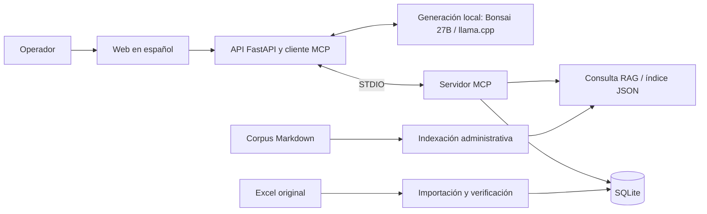
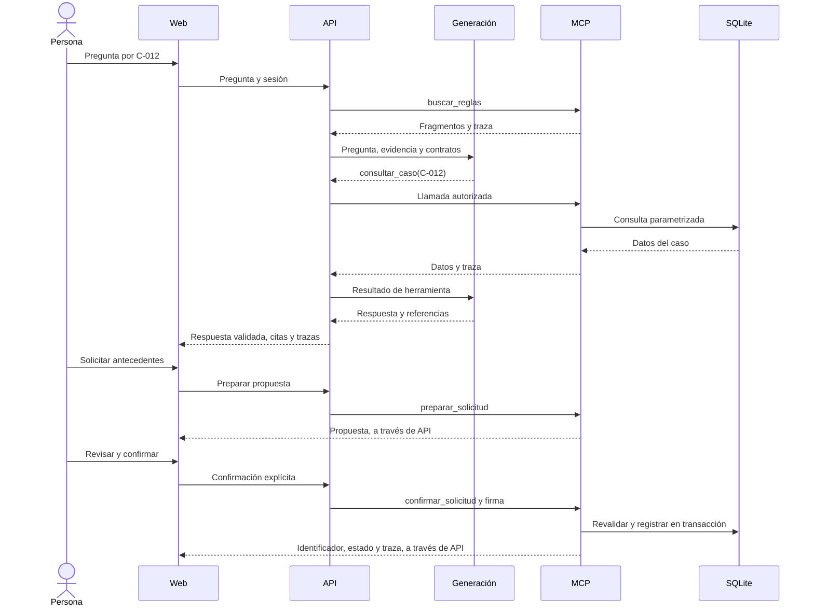

# Entrega 3: evidencia documental y acceso gobernado al sistema MIRA

**Caso de uso:** CU-1, asistente del operador de revisión  
**Institución:** Universidad de Valparaíso, Escuela de Ingeniería Informática  
**Integrantes:** Francisca Meyer - Lukas Scheel - Sebastian Rodriguez<br>
**Representante del cliente:** Francisca Meyer<br>
**Sección:** **CORROBORAR ESTO**.<br>
**Fecha de actualización:** 7 de noviembre de 2026<br>
**Entrega:** 9 de noviembre de 2026, 14:00  
**Repositorio:** <https://github.com/franciscameyer/LLM_E3>  
**Versión técnica:** `v3.0`. Código funcional de referencia: `6e86c44`; el cierre añade documentación y evidencia. La ejecución 06 precede los cambios finales de revisión de evidencias; la suite actual y las rutas sin generación se verificaron nuevamente en `evaluation/cierre_v3_20261107/`.

> Documento de trabajo. Las marcas **CORROBORAR ESTO** identifican información pendiente de confirmación antes de entregar. Los resultados corresponden a evidencias conservadas en el repositorio; actualizar el informe no implica haber ejecutado nuevamente el sistema. La extensión debe verificarse al convertir a PDF: máximos de 0,5; 1,5; 2; 1,5; 1,5; 3; 1 y 1 páginas para las secciones 1 a 8, respectivamente.

## 1. Resumen ejecutivo

La aplicación ayuda al operador de MIRA a entender por qué un caso llegó a revisión, consultar sus antecedentes y preparar solicitudes de información adicional. Reúne en una pantalla los datos autorizados, las reglas que los explican y sus fuentes. Cuando los documentos discrepan, presenta la diferencia; cuando falta información, lo indica. Registrar una solicitud exige confirmación de la persona.

En la última evaluación de respuestas conservada, respondió las 16 preguntas con información disponible y se abstuvo en las cuatro sin respuesta. Encontró las fuentes esperadas para las 16 primeras. La versión actual pasó 47 pruebas y el ensayo de consultas y confirmaciones que no requieren generación. Los veinte resultados no garantizan el mismo desempeño ante cualquier consulta. **CORROBORAR ESTO**: completar la revisión humana y el ensayo integral de conversación.

La demostración utiliza datos ficticios y acceso local. No aprueba ni rechaza casos ni ofrece una instalación lista para producción. Francisca Meyer aprobó las veinte preguntas y expectativas como representante del cliente. Se recomienda cerrar las comprobaciones humanas pendientes y ensayar la conversación en el equipo de presentación antes de ampliar su uso.

## 2. Caso de uso y especificación

### 2.1. Usuario, necesidad y alcance

El CU-1 atiende al operador de una organización cliente que revisa casos derivados. Se eligió porque exige combinar reglas versionadas, datos actuales y acciones sujetas a permiso. Cumple la selección de la pauta §3.2: es autocontenido, utiliza todos los documentos y las tablas del kit elegido, conserva los registros originales y combina RAG con MCP. El kit incluye organizaciones ficticias de distintas industrias; las consultas se restringen al rol y organización de la identidad conectada.

| Necesidad | Componente responsable | Justificación |
| --- | --- | --- |
| Conocer mínimos, señales y procedimientos | Recuperación documental, RAG | Son reglas con fuente, sección y versión. |
| Consultar puntaje, evidencias e historial de un caso | MCP y base de datos | Son hechos del sistema que requieren autorización y una llamada registrada. |
| Explicar una derivación | RAG y MCP | Requiere contrastar reglas con hechos, conservando sus diferencias. |
| Preparar una solicitud de antecedentes | Herramienta MCP | Valida condiciones y guarda una propuesta, sin registrar la solicitud. |
| Registrar la solicitud | Confirmación humana y herramienta MCP | Produce efectos y requiere autorización vinculada a la acción. |

Quedan fuera del alcance aprobar o rechazar casos, modificar políticas, recalcular puntajes e integrar un callback real con sistemas externos.

### 2.2. Conflictos que justifican la solución

MAN-REV v1 §1 indica aprobación automática desde 80 puntos y sin fraude. POL-DEC v2 §2 establece una referencia de 85, mínimos por señal y condiciones adicionales. Ambos documentos se declaran vigentes: la aplicación presenta ambas reglas y no declara derogado el manual.

En C-012, la plataforma reporta 86 puntos y un umbral de 90 para ORG-01. Sin embargo, CU-001 registra una sola aprobación del cambio, mientras POL-DEC v2 §5 exige dos supervisores. El sistema informa la discrepancia: el valor reportado por la plataforma no acredita por sí solo su validez normativa.

### 2.3. Flujos y requisitos

El flujo principal comprende: iniciar sesión, seleccionar un caso autorizado, preguntar por su derivación, consultar documentos y datos mediante MCP, revisar respuesta/citas/trazas, preparar antecedentes y confirmar su registro. La interfaz muestra el identificador de la solicitud y el estado resultante. Repetir una confirmación válida no duplica el efecto.

Los flujos alternativos especifican cómo termina la consulta o acción:

| Condición y ejemplo | Comportamiento y resultado verificable |
| --- | --- |
| Pesos del puntaje no documentados | Abstenerse e identificar la información faltante; no inventar porcentajes. |
| MAN-REV v1 §1 frente a POL-DEC v2 §2 | Presentar ambas reglas con citas, sin elegir precedencia. |
| Fraude: descuento de v1 frente a derivación de v2 | Explicar el cambio con versiones identificadas; usar la vigente para la regla actual. |
| U-01 solicita C-020 o U-03 abre una ficha | Denegar por organización o rol; no mostrar datos del caso. |
| U-01 prepara una tercera solicitud para C-016 | Informar el límite y no crear la propuesta; un supervisor autorizado sí puede prepararla. |
| Caso aprobado automáticamente | Bloquear solicitudes de antecedentes incluso para supervisor, según PRO-ANT §4. |
| Propuesta cancelada, vencida, de otra sesión o firma inválida | No registrar solicitud ni evento; informar la causa o pedir una nueva propuesta. |
| Confirmación repetida válida | Devolver el resultado previo sin duplicar solicitud ni evento. |
| Evidencia E-007 o revisión simple de C-031 | Consultar por MCP, informar patrones detectados y límites de la revisión; no ejecutar instrucciones de la evidencia. |
| Cita inválida o servicio caído | Retener la respuesta o informar indisponibilidad, conservando trazas; no inventar una alternativa. |

Hay ocho usuarios: tres operadores, cuatro supervisores y uno con rol de consulta de indicadores. Operadores y supervisores acceden a los casos de su organización; solo el supervisor puede superar dos solicitudes por caso, con confirmación. El rol de indicadores puede consultar documentos, pero este CU-1 no implementa un panel de indicadores ni le permite abrir fichas individuales. El chat es general: seleccionar un caso propone una pregunta con su ID, sin crear una conversación independiente ni conservar contexto entre preguntas.

| ID | Requisito verificable | Fuente | Criterio de aceptación |
| --- | --- | --- | --- |
| RF-01 | Explicar sin decidir | PR-1 | No existe herramienta para aprobar o rechazar casos. |
| RF-02 | Citar cada afirmación normativa | PR-2 | La cita abre un fragmento recibido con fuente, sección y versión. |
| RF-03 | Abstenerse ante evidencia insuficiente | PR-3 | Las preguntas sin respuesta indican qué información falta. |
| RF-04 | Presentar conflictos sin elegir | PR-4 | La discrepancia 80/85 incluye ambas fuentes vigentes. |
| RF-05 | Obtener datos de casos por MCP | PR-5 | Los datos presentados tienen una llamada registrada en esa consulta. |
| RF-06 | Exigir confirmación para efectos de negocio | PR-6 | Preparar no registra; confirmar exige autorización válida. |
| RF-07 | Restringir por rol y organización | PR-7 | U-01 no consulta C-020; U-03 no accede a fichas individuales. |
| RF-08 | Validar límites y estados antes de escribir | PRO-ANT v1 §4 | El operador no registra una tercera solicitud en C-016. |
| RF-09 | Conservar los registros originales | Pauta §3.2 | La importación verifica el Excel; los cambios de estado se añaden como eventos. |
| RF-10 | Mantener la vigencia documental | Pauta §§4 y 7.1 | Excluir derogadas en consultas operativas; identificar versiones en comparaciones históricas. |
| RNF-01 | Separar indexación y consulta | Pauta §6.2 | Preparar el índice y buscar son operaciones independientes. |
| RNF-02 | Mostrar errores, citas y trazas en español | Pauta §6.1 | Una caída del servicio se informa sin respuesta sustitutiva. |

Los siete principios se encuentran formalizados en `docs/constitucion.md`; la especificación ampliada está en `docs/especificacion-cu1.md`. MIRA v1.4 está representada en el índice por extractos de §§2.6, 2.7, 2.11 y 2.13. Se revisó además el capítulo 7 del documento original y el informe y las actas de usabilidad de E2; el contraste está en `docs/contraste-antecedentes.md`. ENT4, 00:16:26, y ENT5, 00:05:07, justifican reunir evidencia y motivo en pantalla. ENT4, 00:11:06, frente a ENT6, 00:21:16, exige conservar la discrepancia entre modificación unilateral y doble aprobación. Los antecedentes se analizaron sin agregarlos silenciosamente al corpus ni importar políticas particulares de E2. **CORROBORAR ESTO**: aportar la corrección oficial del docente de E2, no localizada entre los documentos revisados.

## 3. Diseño e implementación del RAG

### 3.1. Corpus e inventario

El corpus contiene los seis Markdown obligatorios del kit CU-1 y `corpus/descripcion/MIRA_v1.4.md`, con cuatro extractos de la Descripción del proyecto. Los seis primeros tienen origen kit docente; el séptimo tiene origen Descripción y estado de contexto, sin vigencia normativa declarada. No se redactó una regla adicional para resolver contradicciones. El inventario conserva código, título, archivo, origen, versión, estado, vigencia y huella SHA-256. El tamaño se estima como palabras divididas por 0,75; no corresponde a un conteo exacto del motor de generación.

| Código y versión | Título | Estado | Vigencia declarada | Tokens aproximados |
| --- | --- | --- | --- | ---: |
| CAT-SEN v3 | Catálogo de señales de MIRA | Vigente | Desde 01-09-2026 | 752 |
| FAQ-OPE v2 | Preguntas frecuentes de operadores | Vigente | Desde 01-10-2026 | 383 |
| MAN-REV v1 | Manual de revisión asistida para operadores | Vigente | Desde 15-07-2026 | 607 |
| POL-DEC v1 | Política de decisión y umbrales | Derogada | 02-03-2026 a 31-08-2026 | 359 |
| POL-DEC v2 | Política de decisión y umbrales | Vigente | Desde 01-09-2026 | 704 |
| PRO-ANT v1 | Procedimiento de solicitud de antecedentes | Vigente | Desde 15-07-2026 | 471 |
| MIRA-DESC v1.4 | Descripción del proyecto MIRA · extractos para CU-1 | Contexto | Sin vigencia normativa; documento del 12-08-2026 | 972 |
| **Total** | **7 documentos: 6 del kit y 1 de contexto** | | | **4248** |

Los extractos de MIRA-DESC conservan los títulos y párrafos seleccionados, la fecha y la huella del documento original. Describen decisión, revisión asistida, auditoría y aislamiento. Los requisitos allí descritos, como descargar el rastro o conservar evidencia durante 90 días, se atribuyen al levantamiento; su presencia en el corpus no significa que estén implementados en este CU-1.

### 3.2. Indexación, fragmentación y búsqueda

La indexación lee metadatos únicamente del encabezado y divide el contenido por secciones Markdown. Las secciones extensas se subdividen por líneas con un máximo configurable de caracteres. Cada fragmento hereda metadatos y recibe un identificador como `POL-DEC@2#s02:01`, que distingue documento, versión, sección y parte. El índice se guarda en JSON mediante reemplazo de un archivo temporal.

La consulta utiliza BM25 local. Normaliza mayúsculas y tildes, elimina palabras frecuentes y conserva códigos de señales con guion bajo. Puntúa coincidencias en código, título, encabezado de sección y cuerpo. Por defecto excluye documentos derogados, fechas fuera de vigencia y documentos de contexto. La consulta histórica permite comparar versiones identificándolas como tales. MIRA-DESC se incorpora al mencionar explícitamente la Descripción, el levantamiento o v1.4; se reserva un lugar para su sección más relevante y se refuerzan coincidencias con su encabezado.

Se eligió recuperación léxica por el corpus reducido, los códigos especializados y el costo operativo local. No necesita embeddings ni base vectorial. Su límite es la dependencia del vocabulario: una paráfrasis sin términos compartidos puede perder evidencia relevante.

El ranking incorpora una relación explícita del conflicto 80/85 identificada al analizar el kit. Según la consulta, prioriza las dos fuentes o añade la contraparte como complemento. Por tanto, los resultados corresponden a **BM25 con tratamiento explícito de ese conflicto**, no a BM25 puro. Los complementos fuera de los seis resultados base se excluyen de Recall@6.

Cuando la consulta pide contrastar MIRA v1.4, se agregan las fuentes pertinentes: §2.6 frente a MAN-REV §1 y POL-DEC v2 §2 para decisión, o §2.13 frente a POL-DEC v2 §5 para configuración. Se distingue la atribución del diseño de flujos del requisito de dos aprobaciones. La Descripción no corrige en silencio las contradicciones del kit.

### 3.3. Experimento de fragmentación

Se compararon cuatro límites manteniendo preguntas y texto esperado. Un objetivo solo cuenta como recuperado si todas sus partes aparecen dentro de los seis resultados; encontrar una parte con el mismo sufijo de identificador no basta.

| Máximo de caracteres | Fragmentos | Objetivos completos | Preguntas con todos sus objetivos | Contexto medio, caracteres |
| ---: | ---: | ---: | ---: | ---: |
| 300 | 67 | 10/18 | 8/16 | 1117,60 |
| 600 | 45 | 17/18 | 15/16 | 1678,10 |
| 900 | 41 | 18/18 | 16/16 | 1728,85 |
| 1800 | 39 | 18/18 | 16/16 | 1728,85 |

Se mantiene 1800 para conservar secciones, tablas e identificadores existentes y representar las cuatro secciones de MIRA-DESC en cuatro fragmentos. Empata con 900 en el golden original; no se concluye superioridad en calidad de respuesta. Los límites menores reducen contexto, pero pierden contenido esperado. La comparación actual se conserva en `evaluation/descripcion_v14/fragmentacion.json`; el experimento previo de seis documentos permanece como histórico. Las preguntas originales no solicitan MIRA-DESC: estos resultados no miden por sí solos la recuperación de los nuevos extractos, que se contrasta por separado.

### 3.4. Citas y políticas de respuesta

La respuesta diferencia evidencia, abstención y conflicto. Las referencias cortas F1/F2 se asignan solo a fragmentos mostrados en la consulta y se resuelven por correspondencia exacta a sus identificadores originales. Una fuente recuperada pero no enviada al contexto tampoco puede citarse.

Una referencia inválida permite un único reintento con la misma evidencia, sin herramientas adicionales; si persiste, la respuesta se retiene. Este control comprueba procedencia, no respaldo semántico. Las normas derogadas no se presentan como vigentes, la contradicción conocida exige ambas fuentes y la ausencia de reglas no se convierte en autorización favorable.

La versión actual identifica las fuentes faltantes cuando retiene una respuesta por conflicto y permite abrir las fuentes del contraste. Los conflictos obtenidos solo desde el motivo del caso se incorporan como contexto no obligatorio; pasan a exigirse si la respuesta cita sus reglas o la búsqueda de la pregunta los establece como obligatorios. Así se evita imponer un contraste de umbrales a una revisión acotada de evidencia.

## 4. Diseño e implementación del servidor MCP

### 4.1. Transporte, identidad y datos

El servidor propio utiliza FastMCP mediante STDIO. La API actúa como cliente MCP y elige la conexión correspondiente a usuario y sesión. El motor de generación recibe contratos de herramientas y puede seleccionar nombre y argumentos; nunca recibe acceso SQL ni argumentos para cambiar rol u organización.

SQLite contiene las siete tablas importadas: organizaciones (3 filas), usuarios (8), casos (14), señales (68), evidencias (15), solicitudes de antecedentes (2) y cambios de umbral (2). Los originales se verifican contra el Excel. Nuevas solicitudes, propuestas, eventos y auditoría se almacenan sin reemplazar los registros entregados.

La identidad se transmite mediante un token firmado fuera del contexto de generación. En operación, el acceso a la base de negocio se concentra en el servidor MCP; la importación administrativa y las verificaciones son operaciones separadas.

### 4.2. Contratos y primitivas

| Herramienta | Entrada principal | Salida y control |
| --- | --- | --- |
| `buscar_reglas` | `pregunta: str`, `k: int=6`, `historico: bool=false` | Devuelve fragmentos, complementos, conflictos y advertencia. Usuario identificado; pregunta no vacía y k de 1 a 12. Vigentes por defecto; contexto por mención explícita. Entrada inválida: error explicativo. Sin efecto de negocio. |
| `listar_casos` | Sin argumentos | Lista ID, proceso, puntaje, motivo, vencimiento y estado de los casos propios. Solo operador/supervisor; otro rol se deniega. Sin efecto de negocio. |
| `consultar_caso` | `caso_id: str` | Ficha, organización, umbrales, señales, evidencias, solicitudes, discrepancias y reglas relacionadas. Operador/supervisor y misma organización; caso ajeno o inexistente devuelve «Caso no disponible». Aísla instrucciones conocidas. |
| `listar_senales` | `caso_id: str` | Filas de señales del caso; exige la misma visibilidad que la ficha. Deniega caso o rol no autorizado. Sin efecto de negocio. |
| `preparar_solicitud` | `caso_id: str`, `documentos: str`, `motivo: str` | ID, contenido, reglas, efecto y caducidad de propuesta. Documentos: 5–1000 caracteres; motivo: 10–1500, tras recortar espacios. Valida rol, organización, estado y límite. Propuesta por 600 s; no registra solicitud. |
| `confirmar_solicitud` | `accion_id: str`, `autorizacion: str` | ID de solicitud, caso, estado, autor, fecha y aviso simulado; repetición válida marcada sin efecto. Exige firma por usuario/sesión/acción y propuesta propia vigente. Firma, caducidad, estado o límite inválido: error sin registro de negocio. |
| `ver_propuestas` | Sin argumentos | Propuestas propias de usuario/sesión, pendientes y no vencidas; lista vacía si no hay. Sin efecto de negocio. |
| `cancelar_propuesta` | `accion_id: str` | `{cancelada: true, accion_id}`. Solo propuesta propia pendiente; de otro modo «Propuesta no disponible». Cambia únicamente la propuesta. |
| `ver_trazas` | Sin argumentos | Hasta 40 llamadas anteriores de usuario/sesión, con argumentos y resultados. Incluye fallidas; no revela registros de otras sesiones. |

Solo las primeras cinco herramientas se ofrecen al componente de generación. La aplicación controla la confirmación. El servidor publica además el recurso `mira://corpus/inventario` y el prompt `revisar_caso(caso_id)`, que orienta la consulta sin ejecutar acciones ni conceder permisos.

El contrato de negocio devuelve `{ok, datos, traza}` o `{ok: false, error, traza}`. La traza contiene identificador, fecha, usuario, herramienta, argumentos, resultado y estado. No guarda la autorización de confirmación entre los argumentos visibles. Los errores de identidad o esquema pueden proceder del protocolo antes de construir una traza de negocio. Las herramientas de lectura no alteran el negocio, aunque registran auditoría.

### 4.3. Escritura gobernada

Las consultas son parametrizadas y escritas en el servidor. En C-016, el servidor cuenta las dos solicitudes existentes y bloquea una tercera de un operador según PRO-ANT §4. La restricción no depende del texto de la respuesta.

Preparar persiste únicamente una propuesta. Al confirmar, el backend emite una autorización firmada por 30 segundos vinculada a usuario, sesión y acción. El servidor ejecuta `BEGIN IMMEDIATE`, revalida permisos y límites y registra solicitud, evento y aviso de origen en una transacción. La repetición válida no duplica el efecto. El aviso es una cola simulada: no acredita recepción por un sistema externo.

Los esquemas, restricciones de longitud y errores se detallan en `docs/contratos-mcp.md`. La verificación repetida con cliente externo por STDIO enumeró herramientas, recurso y prompt y comprobó denegación por organización, límite, preparación y cancelación, en una base temporal. Evidencia: `evaluation/cierre_v3_20261107/mcp_externo.json`. Existe configuración gráfica en `.vscode/mcp.json`. **CORROBORAR ESTO**: ensayar ese cliente gráfico con el equipo de presentación.

## 5. Arquitectura e implementación de frontend y backend

### 5.1. Componentes



El frontend utiliza HTML, CSS y JavaScript; muestra conversación, estados, fragmentos abiertos, ficha, propuestas y trazas. Las citas muestran origen y mantienen números de sección completos, como §2.13. FastAPI gestiona sesiones, validación web y orquestación. El servicio RAG separa construcción y consulta del índice. El backend web no ejecuta consultas SQL de negocio directamente.

### 5.2. Secuencia de consulta y confirmación



### 5.3. Datos procesados y límites operativos

La generación funciona localmente mediante llama.cpp, con contexto de 8192 tokens, temperatura 0,1, máximo de salida de 1000 tokens y una conversación en inferencia. Recibe la pregunta actual, instrucciones, contratos, fragmentos y resultados autorizados. No recibe contraseña de demostración, cookies, claves de sesión ni autorizaciones de confirmación. Tampoco recibe el historial completo de conversaciones anteriores.

El bucle limita rondas, llamadas y tiempos de espera. La respuesta se valida antes de enviarla a la interfaz. Los errores del proveedor o del contrato se presentan explícitamente. El modo «Solo documentos» muestra recuperación sin simular una respuesta generada.

Las preguntas simples reconocidas sobre instrucciones o intentos de manipulación en la evidencia de un único caso siguen una ruta directa: `consultar_caso` verifica permisos y devuelve texto y alertas; la aplicación informa evidencias revisadas, alertas y archivos sin texto, sin pasar por generación. Si el control no detecta patrones, no garantiza ausencia de manipulación. Las consultas compuestas o que no coinciden con el patrón mantienen el recorrido general. El diagrama de secuencia anterior representa este recorrido general, no la excepción de revisión directa.

La instalación documentada utiliza Windows y Python 3.12, con dependencias fijadas. Los pesos y binarios se obtienen por separado y sus rutas se configuran en `.env`. El acceso con usuarios ficticios y contraseña compartida sirve para demostración; no constituye autenticación productiva. El repositorio contiene código y evidencias históricas; su presencia no acredita que la instalación actual esté preparada o que cada cambio haya sido ensayado. **CORROBORAR ESTO**: comprobar instalación, rendimiento e interfaz en el equipo definitivo.

**CORROBORAR ESTO — declaración de contribuciones para C5:** completar, a partir del historial de desarrollo, qué se implementó, con qué apoyos, quién lo revisó y qué comprobaciones realizó el equipo. Identificar responsables de RAG, MCP, interfaz e integración, evaluación y documentación. Esta declaración debe reflejar el trabajo real; los campos pendientes no acreditan revisión humana ni autoría individual.

## 6. Evaluación

### 6.1. Diseño y trazabilidad

El golden set se fijó en el commit `089b2fb`, anterior a la primera ejecución completa, y se conserva en `evaluation/golden.json`. Cada pregunta registra ID, formulación, fragmentos esperados, respuesta esperada, tipo y si debe responder.

| Tipo | Cantidad | Comportamiento esperado |
| --- | ---: | --- |
| Con respuesta | 12 | Responder con respaldo en el fragmento esperado. |
| Sin respuesta | 4 | Abstenerse y explicar qué falta. |
| Conflicto vigente | 2 | Presentar ambas fuentes sin escoger. |
| Cambio entre versiones | 2 | Aplicar la vigente e identificar la diferencia. |
| **Total** | **20** | |

Francisca Meyer, representante del cliente de E3, revisó y aprobó las veinte preguntas y expectativas el 7 de noviembre de 2026, según confirmación explícita comunicada por el usuario. `docs/validacion-golden-cliente.md` presenta el conjunto y `evaluation/cierre_v3_20261107/aprobacion_cliente.json` registra versión, huellas y procedencia de la confirmación. El golden original se conserva sin reescribir su estado histórico. Esta aprobación no equivale a revisión humana de las respuestas generadas ni a una firma digital.

Las ejecuciones se guardan por separado, con respuestas, trazas y huellas. La ejecución 06 es la referencia más reciente para el golden con corpus ampliado; las anteriores documentan fallos y mejoras. Al normalizar finales de línea a LF, sus huellas difieren del código actual en `mira/agent.py` y `mira/mcp_server.py`, modificados después para revisar evidencias y explicar bloqueos. La suite actual y las rutas afectadas sin generación se reejecutaron sobre `6e86c44`, en entorno temporal separado. **CORROBORAR ESTO**: repetir la generación del golden y las consultas dirigidas cuando esté disponible Bonsai; las cifras de ejecución 06 no certifican respuestas nuevas de los cambios finales. La preparación administrativa no debe sobrescribir evidencias históricas.

### 6.2. Métricas y resultados conservados

Recall@6 se informa de dos maneras: preguntas con todos sus objetivos recuperados sobre preguntas con respuesta, y objetivos documentales completos recuperados sobre objetivos esperados. En ambos casos se comprueban identificadores de fragmento, no solo documentos.

La precisión de cita es citas respaldadas dividido por citas emitidas; la fidelidad es respuestas completamente respaldadas dividido por respuestas evaluadas. Se cuenta cada par único de respuesta y fragmento: repetir una referencia dentro de una respuesta no aumenta el denominador. La abstención se mide por separado en preguntas sin respuesta y con respuesta. Conflicto y vigencia se calculan sobre sus cuatro preguntas específicas. Los juicios de contenido conservados son automáticos y provisionales; no constituyen revisión humana ni aceptación del cliente.

| Indicador | Resultado conservado | Interpretación |
| --- | ---: | --- |
| Recall@6 por pregunta, con contenido completo | 16/16, 100 % | Todas las preguntas con respuesta recuperaron sus objetivos en el experimento de 1800 caracteres. |
| Recuperación por objetivo documental completo | 18/18, 100 % | Excluye complementos fuera de k. |
| Finalización sin error de servicio o contrato | 20/20, 100 % | No acredita corrección semántica por sí sola. |
| Abstención correcta en preguntas sin respuesta | 4/4, 100 % | Las cuatro preguntas sin respuesta produjeron abstención. |
| Abstención injustificada en preguntas con respuesta | 0/16, 0 % | No hubo abstenciones en ese grupo. |
| Precisión de cita, provisional | 30/30, 100 % | **CORROBORAR ESTO**: contraste humano del respaldo de cada cita. |
| Fidelidad, provisional | 20/20, 100 % | **CORROBORAR ESTO**: revisión humana independiente. |
| Conflicto y vigencia, provisional | 4/4, 100 % | **CORROBORAR ESTO**: verificar que las respuestas cumplen ambos comportamientos. |
| Pruebas automatizadas de la versión actual | 47/47 | Reejecución del 07-11 sobre `6e86c44`, sin fallos, errores ni omisiones. |

En ejecución 06, los estados fueron 13 respuestas con evidencia, cuatro abstenciones y tres conflictos. Que aparezcan tres estados de conflicto es compatible con dos preguntas de esa categoría: una pregunta de otro tipo también recupera una discrepancia pertinente.

El tiempo registrado de extremo a extremo por pregunta en ejecución 06 fue de 5,72 segundos en promedio, mediana de 4,88 y rango de 1,11 a 12,31. Son 20 consultas secuenciales, no una prueba de carga. Incluyen rutas de control distintas; no representan el tiempo puro de generación. No se infiere desempeño concurrente ni equivalencia con otro equipo, ni se atribuye causalmente la diferencia frente a ejecuciones previas a un único cambio.

Se conservaron además cinco consultas dirigidas en `evaluation/descripcion_v14/contrastes.json`: decisión 80/85 y rechazo bajo 60; configuración de umbrales; pantalla del operador; auditoría y conservación; y plazo de conservación solicitado exclusivamente al kit. Las cinco superaron el control estructural. Las dos primeras presentan los contrastes y la última se abstiene: los 90 días pertenecen a MIRA-DESC §2.11 y no deben atribuirse a la política del kit. Estas cinco consultas no amplían el denominador del golden ni equivalen a validación del cliente. **CORROBORAR ESTO**: revisar su contenido con el equipo y repetirlas si cambia el comportamiento.

### 6.3. Pruebas y revisión humana pendiente

Las pruebas emplean bases y directorios temporales. Cubren importación y preservación de originales, metadatos, vigencia, conflictos, roles, organizaciones, entradas maliciosas, SQL parametrizado, propuestas sin efecto, firmas, caducidad, concurrencia, idempotencia, cliente MCP, sesión web, CSRF y manejo de errores. La suite actual pasó 47 pruebas en 84,11 segundos: `evaluation/cierre_v3_20261107/pruebas.xml`. Incluye los tres escenarios finales de revisión directa —C-031 autorizado, C-014 con alerta y C-031 de otra organización— y la comprobación del mensaje de conflicto y sus fuentes. Los registros de 40 y 44 pruebas permanecen como históricos; las pruebas con proveedor simulado no acreditan funcionamiento actual de Bonsai.

La muestra humana prevista incluye R01, R08, A01, A02, A04, C01, C02 y V02: ocho de veinte preguntas, seleccionadas para cubrir categorías y situaciones sensibles. Es dirigida, no aleatoria. La plantilla de ejecución 05 permanece como antecedente, pero sus juicios no se transfieren a nuevas respuestas. `evaluation/ejecucion_06/revision_manual.csv` contiene las veinte preguntas y mantiene vacíos los campos de respaldo, fidelidad y revisor. **CORROBORAR ESTO**: completar una revisión referida explícitamente a ejecución 06 o a la nueva ejecución final y conservar su huella.

**CORROBORAR ESTO**: completar revisor, fecha, citas respaldadas, fidelidad y conflicto/vigencia. Comparar con los juicios provisionales y reportar acuerdos sobre juicios comparados por dimensión. Si hay desacuerdo, releer las fuentes, conservar ambas evaluaciones y registrar su resolución. La concordancia humana todavía no está medida; no corresponde informarla como 0 % ni 100 %.

La clasificación de fallos sigue este orden: primero comprobar si se recuperaron los fragmentos necesarios; su ausencia es fallo de recuperación. Si la evidencia llegó y la respuesta la omite, la contradice o añade afirmaciones sin respaldo, es fallo de generación. Se registran aparte errores de servicio, orquestación y validación para no atribuirlos incorrectamente a la búsqueda. La estrategia combina pruebas aisladas de reglas y permisos, integración MCP/API, evaluación del conjunto fijo y consultas dirigidas de regresión.

Una nueva revisión técnica de las ocho respuestas guardadas verificó 14/14 citas respaldadas y 8/8 respuestas fieles. Coincidió con los juicios previos en fidelidad 8/8, cantidad de citas respaldadas 8/8 y conflicto/vigencia 3/3; no encontró discrepancias en la muestra. Los resultados y su alcance están en `evaluation/cierre_v3_20261107/revision_tecnica_muestra.json` y `concordancia_tecnica.json`. Es concordancia técnica, no humana. `docs/paquete-revision-humana.md` reúne respuestas y fragmentos; la planilla humana conserva vacíos sus juicios, revisor y fecha.

El ensayo sin Bonsai comprobó nueve escenarios por API: cita consultable, recuperación del conflicto, abstención controlada de credenciales, manipulación conocida, aislamiento de organización, límite de solicitudes, confirmación e idempotencia, trazas y consulta fuera del golden. En la interfaz se abrieron ambas citas, se preparó C-011 sin registrar, se marcó la confirmación, se verificó una solicitud y un evento, se abrió su traza y se mostró la alerta de E-007. La base original se conservó. La consulta exploratoria fue preparada en este ensayo y no se declara pregunta sorpresa de otra persona. Evidencia: `ensayo_api_sin_bonsai.json`, `ensayo_interfaz.json`, `antes_confirmacion.json` y `despues_confirmacion.json`, en la carpeta de cierre.

### 6.4. Análisis de fallos y ciclo de mejora

| Caso observado | Clasificación | Corrección y evidencia posterior | Límite |
| --- | --- | --- | --- |
| Una columna «Código» del cuerpo de CAT-SEN reemplazaba el código documental | Indexación / recuperación | Lectura restringida al encabezado y prueba de regresión de metadatos. | No detecta por sí sola cualquier encabezado mal formado. |
| R10 añadía una regla de umbral ajena a la pregunta y omitía su contradicción | Generación | Ajuste de orden de evidencia y control de ambas fuentes si se usa la regla; la repetición respondió con PRO-ANT §4. | El filtro estructural no garantiza relevancia semántica universal. |
| C01/C02 de ejecución 03 atribuían ambiguamente configuración viva a una sección normativa | Generación / fidelidad | Separación explícita entre ficha MCP y política; la observación no reapareció en ejecuciones 04 y 05 según los juicios conservados. | Requiere corroboración humana; no demuestra eliminación general del fallo. |
| P07 no recibía la regla relevante para una señal faltante y emitía referencias inválidas | Recuperación y generación | Recuperación desde el motivo registrado y referencias cortas exactas; tres repeticiones finales con POL-DEC v2 §6, sin reintento. | Persiste sobrecitación documental de hechos de la ficha en revisión dirigida. |
| A04 se abstenía, pero añadía canales de recuperación de credenciales no documentados | Generación / fidelidad | Abstención controlada para peticiones directas de secretos; tres repeticiones sin inventar recuperación. | La detección por patrones no garantiza cubrir todas las formulaciones. |
| Una denegación de permisos terminaba en error de cita durante la reformulación | Generación posterior a control de acceso | Se muestra directamente la denegación MCP con traza; pruebas por rol y organización. | El control de acceso y la calidad de redacción son verificaciones distintas. |
| Una revisión simple de C-031 podía bloquearse por el contraste de umbrales recuperado desde su motivo | Orquestación / validación | Revisión directa por MCP y conflictos del motivo no obligatorios salvo uso de sus reglas. Los tres escenarios pasaron en la suite actual y se comprobaron rutas autorizadas y denegadas por API. | Ruta limitada a formulaciones reconocidas y patrones de texto conocidos. |
| El bloqueo de una respuesta no indicaba qué fuente del contraste faltaba | Presentación del error de validación | Se nombran las fuentes omitidas o la falta de señalización del conflicto; la prueba actual comprueba mensaje y citas del contraste. | Mejora el diagnóstico, pero no corrige automáticamente la respuesta retenida; **CORROBORAR ESTO**: reensayar una respuesta generada retenida en interfaz. |

El golden no se modificó para acomodar estos resultados. Las consultas exploratorias se conservan aparte y no se suman al denominador de veinte preguntas. La sobrecitación observada en P07 impide extender el 100 % provisional del golden a cualquier consulta nueva.

### 6.5. Reproducción

Desde la raíz del repositorio, con Python 3.12 instalado:

```powershell
py -3.12 -m venv .venv
.\.venv\Scripts\python.exe -m pip install -r requirements-lock.txt
.\.venv\Scripts\python.exe -m pip check
.\.venv\Scripts\python.exe -m mira.cli preparar
.\.venv\Scripts\python.exe -m pytest -q
.\.venv\Scripts\python.exe -m mira.validation comparar --salida .cache/comparacion-informe.json
```

Con el servicio de generación configurado y disponible:

```powershell
.\.venv\Scripts\python.exe -m mira.cli evaluar --generacion --salida evaluation/validacion_informe
.\.venv\Scripts\python.exe -m mira.regression_check --salida .cache/regresion-informe --repeticiones 3
.\.venv\Scripts\python.exe -m mira.check_delivery --generacion --salida .cache/mcp-informe.json
```

Las salidas deben ser nuevas para preservar históricos. La evidencia de instalación limpia acredita un entorno nuevo en el mismo equipo, no otro equipo físico. **CORROBORAR ESTO**: ejecutar los comandos en el entorno final y actualizar las cifras si cambian código, corpus, configuración o respuestas.

## 7. Riesgos y controles

| Riesgo | Control configurado | Verificación | Límite residual |
| --- | --- | --- | --- |
| Una evidencia contiene órdenes para aprobar | Contenido tratado como no confiable, aislamiento de E-007, revisión directa reconocida y herramientas limitadas. | Suite actual, revisión por API y alerta visible en interfaz. | Los patrones conocidos no cubren toda manipulación posible. |
| Exposición de datos de otra organización | Identidad firmada, validación de rol y filtro por organización en servidor. | Denegaciones U-01/C-020 y U-03/ficha individual. | La contraseña compartida es solo de demostración. |
| Escritura sin consentimiento | Confirmación separada, firma por acción/sesión y caducidad. | Firma inválida, sesión ajena y propuesta vencida no registran. | Exige proteger equipo y clave local. |
| Duplicación o exceso de solicitudes concurrentes | Transacción inmediata, revalidación e idempotencia. | Pruebas de confirmación simultánea y repetida. | La política de negocio debe mantenerse alineada con las fuentes. |
| Citas válidas que no respaldan lo afirmado | Correspondencia exacta de referencias y evaluación de contenido separada. | Referencias desconocidas retenidas; revisión de respuestas. | La validez del identificador no acredita fidelidad. |
| Uso de reglas derogadas u ocultamiento de conflicto | Filtros de estado/fecha y relación explícita 80/85. | Consultas históricas y presentación de ambas fuentes. | No hay detección garantizada de conflictos nuevos. |
| Confundir el levantamiento con una norma o funcionalidad existente | MIRA-DESC se etiqueta como contexto y se recupera por mención explícita, con fuentes de contraste. | Cinco consultas dirigidas y pruebas de ampliación del corpus. | Un requisito descrito no acredita su implementación; revisión humana pendiente. |
| Inyección SQL o modificación de originales | Parámetros separados, verificaciones de integridad y restricciones de modificación. | Entradas maliciosas y comparación contra Excel. | La administración local requiere acceso protegido. |
| Caída del servicio o solicitudes web ajenas | Errores explícitos, cookies HttpOnly/SameSite, CSRF y comprobación de origen/host. | Pruebas de indisponibilidad y sesión/CSRF. | No sustituye TLS ni autenticación productiva. |

Los controles se aplican en el servidor y no dependen únicamente de una advertencia visible. La acción permitida se limita a solicitar antecedentes: ninguna herramienta convierte una explicación en aprobación o rechazo. **CORROBORAR ESTO**: ensayar los controles visibles de la demostración y verificar las condiciones de despliegue antes de cualquier uso fuera de localhost.

## 8. Discusión y conclusiones

La separación entre documentos, datos y acciones permitió resolver necesidades distintas sin mezclar sus autoridades. RAG aporta la regla identificable; MCP acredita qué reporta el sistema bajo una identidad; la confirmación humana autoriza un efecto concreto. C-012 muestra por qué las tres funciones no son intercambiables: recuperar la política no demuestra el umbral efectivo, y consultar un valor de la base no demuestra que su aprobación cumpla la política.

El conflicto entre manual y política tampoco se resuelve seleccionando la coincidencia más relevante. La recuperación debe preservar ambas fuentes y la respuesta debe reconocer la contradicción. Del mismo modo, la falta de CRUCE_MONTO en C-018 no habilita una conclusión favorable. Ningún componente puede suplir una regla ausente, definir una precedencia no establecida o aprobar por cuenta propia un caso.

La incorporación de MIRA v1.4 permite contrastar el levantamiento con el kit sin confundirlos. Sus referencias de decisión y configuración requieren atribución explícita; los 90 días de conservación son un requisito de contexto, no una regla encontrada en la política del kit ni una función acreditada por este prototipo. La revisión directa de evidencia muestra además que una comprobación acotada puede resolverse con datos autorizados y controles conocidos, sin introducir reglas de umbral ajenas a la pregunta.

El ciclo de evaluación mostró que el éxito estructural es insuficiente. Una respuesta puede citar un identificador existente y atribuirle datos que solo están en la ficha. Los fallos de C01/C02 y la sobrecitación exploratoria de P07 justifican evaluar respaldo y fidelidad además de recuperación. También muestran la necesidad de conservar errores e históricos: corregir una referencia no autoriza a trasladar automáticamente métricas de una ejecución a otra.

La solución ofrece una base funcional para la demostración del CU-1, con recuperación real, servidor MCP y escritura confirmada. Sus resultados se limitan al corpus, preguntas y entorno registrados. No acreditan ausencia de fallos ante preguntas nuevas ni preparación para producción.

Los pendientes concretos de cierre son:

1. Golden aprobado por Francisca Meyer; entrevistas e informe y actas de E2 contrastados. **CORROBORAR ESTO**: incorporar la corrección docente de E2 si existe y las decisiones de producto aún abiertas. Ver `docs/contraste-antecedentes.md`.
2. Suite actual: 47/47; recuperación y consultas sin generación reejecutadas; muestra técnica de ocho respuestas y concordancia documentadas, sin discrepancias detectadas. **CORROBORAR ESTO**: revisión humana, concordancia humana y nueva generación con Bonsai disponible.
3. Citas, abstención controlada, conflicto documental, trazas, efecto confirmado, riesgos y cliente programático externo ensayados. **CORROBORAR ESTO**: cliente gráfico, generación y pregunta sorpresa con participantes para completar el ensayo en vivo.
4. D1–D8 se organizan según los ocho resultados enumerados en P2, con guion en `docs/guion-demostracion-v3.md`; `v3.0` identifica la versión técnica seleccionada. **CORROBORAR ESTO**: contrastar cualquier instrucción adicional del docente; no se registra una confirmación docente inexistente.
5. Integrantes incorporados. **CORROBORAR ESTO**: completar responsabilidades reales de desarrollo, preparar PPT y ajustar este texto a las extensiones máximas al exportar el PDF.

Las fuentes técnicas internas que sustentan el informe son la constitución y especificación del CU-1, el análisis de corpus, los contratos MCP, la arquitectura, los procedimientos de reproducción, las ejecuciones conservadas en `evaluation/ejecucion_01` a `evaluation/ejecucion_06`, la ampliación documentada en `evaluation/descripcion_v14` y las pruebas registradas. Los datos de negocio proceden del Excel original de CU-1. Las fuentes documentales son los seis Markdown del kit y los cuatro extractos identificados de la Descripción MIRA v1.4; el informe distingue los resultados conservados del comportamiento posterior aún pendiente de revalidación.
