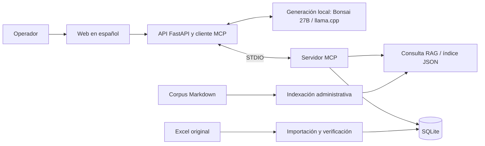
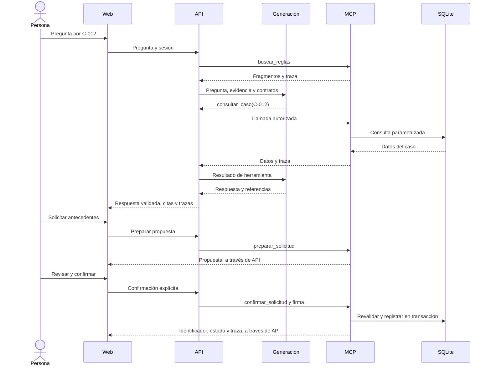

# Entrega 3: evidencia documental y acceso gobernado al sistema MIRA

**Caso de uso:** CU-1, asistente del operador de revisión  
**Institución:** Universidad de Valparaíso, Escuela de Ingeniería Informática  
**Equipo e integrantes:** **CORROBORAR ESTO**: completar nombres y sección.  
**Fecha de elaboración:** 3 de noviembre de 2026  
**Entrega:** 9 de noviembre de 2026, 14:00  
**Repositorio:** <https://github.com/franciscameyer/LLM_E3>  
**Referencia del código revisado:** commit `bfb0184`.

> Documento de trabajo. Las marcas **CORROBORAR ESTO** identifican información pendiente de confirmación antes de entregar. Los resultados corresponden a evidencias conservadas en el repositorio; no constituyen una nueva ejecución realizada el 3 de noviembre. La extensión debe verificarse al convertir a PDF: máximos de 0,5; 1,5; 2; 1,5; 1,5; 3; 1 y 1 páginas para las secciones 1 a 8, respectivamente.

## 1. Resumen ejecutivo

MIRA deriva a revisión humana los casos que no resuelve automáticamente. El operador necesita entender la derivación, consultar los antecedentes y conocer las reglas aplicables sin recorrer sistemas separados. La solución implementa una aplicación web en español que reúne documentos citables, consultas autorizadas a los registros del caso y preparación de solicitudes de antecedentes. La decisión permanece en la persona: registrar una solicitud exige revisar una propuesta y confirmarla expresamente.

La solución conserva los seis documentos y las siete tablas originales del kit CU-1. Distingue reglas documentales de datos del sistema, muestra discrepancias entre fuentes, identifica normas derogadas y se abstiene cuando falta información. Por ejemplo, presenta el conflicto entre los umbrales 80 y 85 sin escoger una precedencia que el corpus no establece.

En la ejecución conservada más reciente, las 20 preguntas terminaron sin errores de servicio o contrato: hubo abstención en las cuatro preguntas sin respuesta y ninguna abstención injustificada en las otras 16. La recuperación encontró todos los objetivos documentales en las 16 preguntas con respuesta. El registro de pruebas contiene 40 casos aprobados. **CORROBORAR ESTO**: completar el contraste humano de las cifras provisionales de respaldo de citas y fidelidad, y obtener la validación del cliente sobre las respuestas esperadas.

La aplicación es una demostración local con datos ficticios, no una instalación productiva. No aprueba ni rechaza casos, no completa información ausente y no modifica las fuentes originales. Se recomienda cerrar las validaciones pendientes y ensayar la operación en el equipo de presentación antes de ampliar su alcance.

## 2. Caso de uso y especificación

### 2.1. Usuario, necesidad y alcance

El CU-1 atiende al operador de una organización cliente que revisa casos derivados. Se eligió porque exige combinar reglas versionadas, datos actuales y acciones sujetas a permiso. El kit incluye organizaciones ficticias de distintas industrias; las consultas se restringen al rol y organización de la identidad conectada.

| Necesidad | Componente responsable | Justificación |
| --- | --- | --- |
| Conocer mínimos, señales y procedimientos | Recuperación documental, RAG | Son reglas con fuente, sección y versión. |
| Consultar puntaje, evidencias e historial de un caso | MCP y base de datos | Son hechos del sistema que requieren autorización y una llamada registrada. |
| Explicar una derivación | RAG y MCP | Requiere contrastar reglas con hechos, conservando sus diferencias. |
| Preparar una solicitud de antecedentes | Herramienta MCP | Valida condiciones y guarda una propuesta, sin registrar la solicitud. |
| Registrar la solicitud | Confirmación humana y herramienta MCP | Produce efectos y requiere autorización vinculada a la acción. |

Quedan fuera del alcance aprobar o rechazar casos, modificar políticas, recalcular puntajes e integrar un callback real con sistemas externos.

### 2.2. Conflictos que justifican la solución

MAN-REV v1 §1 indica aprobación automática desde 80 puntos y sin fraude. POL-DEC v2 §2 establece una referencia de 85, mínimos por señal y condiciones adicionales. Ambos documentos se declaran vigentes: la aplicación presenta ambas reglas y no declara derogado el manual.

En C-012, la plataforma reporta 86 puntos y un umbral de 90 para ORG-01. Sin embargo, CU-001 registra una sola aprobación del cambio, mientras POL-DEC v2 §5 exige dos supervisores. El sistema informa la discrepancia: el valor reportado por la plataforma no acredita por sí solo su validez normativa.

### 2.3. Flujos y requisitos

El flujo principal comprende: iniciar sesión, seleccionar un caso autorizado, preguntar por su derivación, consultar documentos y datos mediante MCP, revisar respuesta/citas/trazas, preparar antecedentes y confirmar su registro. La interfaz muestra el identificador de la solicitud y el estado resultante. Repetir una confirmación válida no duplica el efecto.

Los flujos alternativos incluyen falta de evidencia, conflicto vigente, norma derogada, acceso denegado, límite de solicitudes alcanzado, propuesta vencida o cancelada y servicio no disponible. Cada uno debe producir una abstención o error comprensible, sin sustituirlo por datos inventados.

| ID | Requisito verificable | Fuente | Criterio de aceptación |
| --- | --- | --- | --- |
| RF-01 | Explicar sin decidir | PR-1 | No existe herramienta para aprobar o rechazar casos. |
| RF-02 | Citar cada afirmación normativa | PR-2 | La cita abre un fragmento recibido con fuente, sección y versión. |
| RF-03 | Abstenerse ante evidencia insuficiente | PR-3 | Las preguntas sin respuesta indican qué información falta. |
| RF-04 | Presentar conflictos sin elegir | PR-4 | La discrepancia 80/85 incluye ambas fuentes vigentes. |
| RF-05 | Obtener datos de casos por MCP | PR-5 | Los datos presentados tienen una llamada registrada en esa consulta. |
| RF-06 | Exigir confirmación para efectos de negocio | PR-6 | Preparar no registra; confirmar exige autorización válida. |
| RF-07 | Restringir por rol y organización | PR-7 | U-01 no consulta C-020; U-03 no accede a fichas individuales. |
| RF-08 | Validar límites y estados antes de escribir | PRO-ANT v1 §4 | El operador no registra una tercera solicitud en C-016. |
| RF-09 | Conservar los registros originales | Pauta §3.2 | La importación verifica el Excel; los cambios de estado se añaden como eventos. |
| RNF-01 | Separar indexación y consulta | Pauta §6.2 | Preparar el índice y buscar son operaciones independientes. |
| RNF-02 | Mostrar errores, citas y trazas en español | Pauta §6.1 | Una caída del servicio se informa sin respuesta sustitutiva. |

Los siete principios se encuentran formalizados en `docs/constitucion.md`; la especificación ampliada está en `docs/especificacion-cu1.md`. **CORROBORAR ESTO**: contrastar alcance y necesidades con MIRA v1.4, entrevistas y retroalimentación de E2, antecedentes no incluidos en este repositorio.

## 3. Diseño e implementación del RAG

### 3.1. Corpus e inventario

El corpus contiene los seis Markdown obligatorios del kit CU-1, todos ficticios y de origen docente. No se agregaron documentos para resolver las contradicciones. El inventario conserva código, título, archivo, origen, versión, estado, vigencia y huella SHA-256. El tamaño se estima como palabras divididas por 0,75; no corresponde a un conteo exacto del motor de generación.

| Código y versión | Título | Estado | Vigencia declarada | Tokens aproximados |
| --- | --- | --- | --- | ---: |
| CAT-SEN v3 | Catálogo de señales de MIRA | Vigente | Desde 01-09-2026 | 752 |
| FAQ-OPE v2 | Preguntas frecuentes de operadores | Vigente | Desde 01-10-2026 | 383 |
| MAN-REV v1 | Manual de revisión asistida para operadores | Vigente | Desde 15-07-2026 | 607 |
| POL-DEC v1 | Política de decisión y umbrales | Derogada | 02-03-2026 a 31-08-2026 | 359 |
| POL-DEC v2 | Política de decisión y umbrales | Vigente | Desde 01-09-2026 | 704 |
| PRO-ANT v1 | Procedimiento de solicitud de antecedentes | Vigente | Desde 15-07-2026 | 471 |
| **Total** | **6 documentos del kit** | | | **3276** |

### 3.2. Indexación, fragmentación y búsqueda

La indexación lee metadatos únicamente del encabezado y divide el contenido por secciones Markdown. Las secciones extensas se subdividen por líneas con un máximo configurable de caracteres. Cada fragmento hereda metadatos y recibe un identificador como `POL-DEC@2#s02:01`, que distingue documento, versión, sección y parte. El índice se guarda en JSON mediante reemplazo de un archivo temporal.

La consulta utiliza BM25 local. Normaliza mayúsculas y tildes, elimina palabras frecuentes y conserva códigos de señales con guion bajo. Puntúa coincidencias en código, título, encabezado de sección y cuerpo. Por defecto excluye documentos derogados y fechas fuera de vigencia. La consulta histórica permite comparar versiones identificándolas como tales.

Se eligió recuperación léxica por el corpus reducido, los códigos especializados y el costo operativo local. No necesita embeddings ni base vectorial. Su límite es la dependencia del vocabulario: una paráfrasis sin términos compartidos puede perder evidencia relevante.

El ranking incorpora una relación explícita del conflicto 80/85 identificada al analizar el kit. Según la consulta, prioriza las dos fuentes o añade la contraparte como complemento. Por tanto, los resultados corresponden a **BM25 con tratamiento explícito de ese conflicto**, no a BM25 puro. Los complementos fuera de los seis resultados base se excluyen de Recall@6.

### 3.3. Experimento de fragmentación

Se compararon cuatro límites manteniendo preguntas y texto esperado. Un objetivo solo cuenta como recuperado si todas sus partes aparecen dentro de los seis resultados; encontrar una parte con el mismo sufijo de identificador no basta.

| Máximo de caracteres | Fragmentos | Objetivos completos | Preguntas con todos sus objetivos | Contexto medio, caracteres |
| ---: | ---: | ---: | ---: | ---: |
| 300 | 50 | 10/18 | 8/16 | 1117,60 |
| 600 | 36 | 17/18 | 15/16 | 1678,10 |
| 900 | 35 | 18/18 | 16/16 | 1728,85 |
| 1800 | 35 | 18/18 | 16/16 | 1728,85 |

Se mantiene 1800 para conservar secciones, tablas e identificadores existentes. Empata con 900 en este corpus; no se concluye superioridad. Los límites menores reducen contexto, pero pierden contenido esperado. La evidencia se conserva en `evaluation/cierre_tecnico/comparacion_fragmentacion.json`.

### 3.4. Citas y políticas de respuesta

La respuesta diferencia evidencia, abstención y conflicto. Las referencias cortas F1/F2 se asignan solo a fragmentos mostrados en la consulta y se resuelven por correspondencia exacta a sus identificadores originales. Una fuente recuperada pero no enviada al contexto tampoco puede citarse.

Una referencia inválida permite un único reintento con la misma evidencia, sin herramientas adicionales; si persiste, la respuesta se retiene. Este control comprueba procedencia, no respaldo semántico. Las normas derogadas no se presentan como vigentes, la contradicción conocida exige ambas fuentes y la ausencia de reglas no se convierte en autorización favorable.

## 4. Diseño e implementación del servidor MCP

### 4.1. Transporte, identidad y datos

El servidor propio utiliza FastMCP mediante STDIO. La API actúa como cliente MCP y elige la conexión correspondiente a usuario y sesión. El motor de generación recibe contratos de herramientas y puede seleccionar nombre y argumentos; nunca recibe acceso SQL ni argumentos para cambiar rol u organización.

SQLite contiene las siete tablas importadas: organizaciones (3 filas), usuarios (8), casos (14), señales (68), evidencias (15), solicitudes de antecedentes (2) y cambios de umbral (2). Los originales se verifican contra el Excel. Nuevas solicitudes, propuestas, eventos y auditoría se almacenan sin reemplazar los registros entregados.

La identidad se transmite mediante un token firmado fuera del contexto de generación. En operación, el acceso a la base de negocio se concentra en el servidor MCP; la importación administrativa y las verificaciones son operaciones separadas.

### 4.2. Contratos y primitivas

| Herramienta | Entrada principal | Salida y control |
| --- | --- | --- |
| `buscar_reglas` | Pregunta, k, histórico | Fragmentos y conflictos; k entre 1 y 12; vigentes por defecto. |
| `listar_casos` | Sin argumentos | Casos de la organización; operador o supervisor. |
| `consultar_caso` | ID de caso | Ficha, señales, evidencias, solicitudes, umbrales y discrepancias; verifica visibilidad. |
| `listar_senales` | ID de caso | Señales del caso autorizado. |
| `preparar_solicitud` | Caso, documentos y motivo | Propuesta por 600 segundos; valida rol, organización, estado y límites. |
| `confirmar_solicitud` | ID de acción y autorización | Registra solicitud y evento; verifica firma, sesión, vigencia e idempotencia. |
| `ver_propuestas` | Sin argumentos | Propuestas pendientes propias de la sesión. |
| `cancelar_propuesta` | ID de acción | Cancela una propuesta propia; no cambia el caso. |
| `ver_trazas` | Sin argumentos | Hasta 40 registros propios de usuario y sesión. |

Solo las primeras cinco herramientas se ofrecen al componente de generación. La aplicación controla la confirmación. El servidor publica además el recurso `mira://corpus/inventario` y el prompt `revisar_caso(caso_id)`, que orienta la consulta sin ejecutar acciones ni conceder permisos.

El contrato de negocio devuelve `{ok, datos, traza}` o `{ok: false, error, traza}`. La traza contiene identificador, fecha, usuario, herramienta, argumentos, resultado y estado. No guarda la autorización de confirmación entre los argumentos visibles. Los errores de identidad o esquema pueden proceder del protocolo antes de construir una traza de negocio. Las herramientas de lectura no alteran el negocio, aunque registran auditoría.

### 4.3. Escritura gobernada

Las consultas son parametrizadas y escritas en el servidor. En C-016, el servidor cuenta las dos solicitudes existentes y bloquea una tercera de un operador según PRO-ANT §4. La restricción no depende del texto de la respuesta.

Preparar persiste únicamente una propuesta. Al confirmar, el backend emite una autorización firmada por 30 segundos vinculada a usuario, sesión y acción. El servidor ejecuta `BEGIN IMMEDIATE`, revalida permisos y límites y registra solicitud, evento y aviso de origen en una transacción. La repetición válida no duplica el efecto. El aviso es una cola simulada: no acredita recepción por un sistema externo.

Los esquemas, restricciones de longitud y errores se detallan en `docs/contratos-mcp.md`. Existe configuración de cliente externo en `.vscode/mcp.json`. **CORROBORAR ESTO**: verificar su funcionamiento visible con el cliente y equipo que se utilizarán en la presentación.

## 5. Arquitectura e implementación de frontend y backend

### 5.1. Componentes



El frontend utiliza HTML, CSS y JavaScript; muestra conversación, estados, fragmentos abiertos, ficha, propuestas y trazas. FastAPI gestiona sesiones, validación web y orquestación. El servicio RAG separa construcción y consulta del índice. El backend web no ejecuta consultas SQL de negocio directamente.

### 5.2. Secuencia de consulta y confirmación



### 5.3. Datos procesados y límites operativos

La generación funciona localmente mediante llama.cpp, con contexto de 8192 tokens, temperatura 0,1, máximo de salida de 1000 tokens y una conversación en inferencia. Recibe la pregunta actual, instrucciones, contratos, fragmentos y resultados autorizados. No recibe contraseña de demostración, cookies, claves de sesión ni autorizaciones de confirmación. Tampoco recibe el historial completo de conversaciones anteriores.

El bucle limita rondas, llamadas y tiempos de espera. La respuesta se valida antes de enviarla a la interfaz. Los errores del proveedor o del contrato se presentan explícitamente. El modo «Solo documentos» muestra recuperación sin simular una respuesta generada.

La instalación documentada utiliza Windows y Python 3.12, con dependencias fijadas. Los pesos y binarios se obtienen por separado y sus rutas se configuran en `.env`. El acceso con usuarios ficticios y contraseña compartida sirve para demostración; no constituye autenticación productiva. **CORROBORAR ESTO**: completar responsabilidades, autoría y verificaciones efectivamente realizadas por cada integrante, y comprobar instalación, rendimiento e interfaz en el equipo definitivo.

## 6. Evaluación

### 6.1. Diseño y trazabilidad

El golden set se fijó en el commit `089b2fb`, anterior a la primera ejecución completa, y se conserva en `evaluation/golden.json`. Cada pregunta registra ID, formulación, fragmentos esperados, respuesta esperada, tipo y si debe responder.

| Tipo | Cantidad | Comportamiento esperado |
| --- | ---: | --- |
| Con respuesta | 12 | Responder con respaldo en el fragmento esperado. |
| Sin respuesta | 4 | Abstenerse y explicar qué falta. |
| Conflicto vigente | 2 | Presentar ambas fuentes sin escoger. |
| Cambio entre versiones | 2 | Aplicar la vigente e identificar la diferencia. |
| **Total** | **20** | |

**CORROBORAR ESTO**: obtener la validación de las respuestas esperadas por el representante del cliente y registrar persona, rol, fecha, versión y observaciones. La composición correcta del conjunto no equivale a esa validación.

Las ejecuciones se guardan por separado, con respuestas, trazas y huellas. La ejecución 05 es la referencia principal; las anteriores documentan fallos y mejoras. Sus fuentes Python coinciden con el contenido actual al normalizar finales de línea a LF: los hashes de bytes cambian en un checkout con CRLF. La preparación administrativa no debe sobrescribir las evidencias históricas.

### 6.2. Métricas y resultados conservados

Recall@6 se informa de dos maneras: preguntas con todos sus objetivos recuperados sobre preguntas con respuesta, y objetivos documentales completos recuperados sobre objetivos esperados. En ambos casos se comprueban identificadores de fragmento, no solo documentos.

La precisión de cita exige que el fragmento respalde la afirmación; la fidelidad exige que todas las afirmaciones estén respaldadas. Se cuenta cada par único de respuesta y fragmento: repetir una referencia dentro de una respuesta no aumenta el denominador. La abstención se mide por separado en preguntas sin respuesta y con respuesta.

| Indicador | Resultado conservado | Interpretación |
| --- | ---: | --- |
| Recall@6 por pregunta, con contenido completo | 16/16, 100 % | Todas las preguntas con respuesta recuperaron sus objetivos en el experimento de 1800 caracteres. |
| Recuperación por objetivo documental completo | 18/18, 100 % | Excluye complementos fuera de k. |
| Finalización sin error de servicio o contrato | 20/20, 100 % | No acredita corrección semántica por sí sola. |
| Abstención correcta en preguntas sin respuesta | 4/4, 100 % | Las cuatro preguntas sin respuesta produjeron abstención. |
| Abstención injustificada en preguntas con respuesta | 0/16, 0 % | No hubo abstenciones en ese grupo. |
| Precisión de cita, provisional | 30/30, 100 % | **CORROBORAR ESTO**: contraste humano del respaldo de cada cita. |
| Fidelidad, provisional | 20/20, 100 % | **CORROBORAR ESTO**: revisión humana independiente. |
| Conflicto y vigencia, provisional | 4/4, 100 % | **CORROBORAR ESTO**: verificar que las respuestas cumplen ambos comportamientos. |
| Pruebas automatizadas registradas | 40/40 | Registro XML sin fallos, errores ni omisiones. |

En ejecución 05, los estados fueron 13 respuestas con evidencia, cuatro abstenciones y tres conflictos. Que aparezcan tres estados de conflicto es compatible con dos preguntas de esa categoría: una pregunta de otro tipo también recupera una discrepancia pertinente.

El tiempo registrado de extremo a extremo por pregunta fue de 6,69 segundos en promedio, mediana de 5,89 y rango de 1,69 a 15,25. Son 20 consultas secuenciales, no una prueba de carga. Incluyen rutas de control distintas; no representan el tiempo puro de generación. No se infiere desempeño concurrente ni equivalencia con otro equipo.

### 6.3. Pruebas y revisión humana pendiente

Las pruebas emplean bases y directorios temporales. Cubren importación y preservación de originales, metadatos, vigencia, conflictos, roles, organizaciones, entradas maliciosas, SQL parametrizado, propuestas sin efecto, firmas, caducidad, concurrencia, idempotencia, cliente MCP, sesión web, CSRF y manejo de errores. El registro `evaluation/correccion_citas_fidelidad/pruebas.xml` contiene 40 aprobaciones del 1 de noviembre; no se presenta como reejecución en este clon.

La muestra humana prevista incluye R01, R08, A01, A02, A04, C01, C02 y V02: ocho de veinte preguntas, seleccionadas para cubrir categorías y situaciones sensibles. Es dirigida, no aleatoria. La planilla `evaluation/ejecucion_05/muestra_humana.csv` conserva los campos de juicio vacíos.

**CORROBORAR ESTO**: completar revisor, fecha, citas respaldadas, fidelidad y conflicto/vigencia. Comparar con los juicios provisionales y reportar acuerdos sobre juicios comparados por dimensión. Si hay desacuerdo, releer las fuentes, conservar ambas evaluaciones y registrar su resolución. La concordancia humana todavía no está medida; no corresponde informarla como 0 % ni 100 %.

### 6.4. Análisis de fallos y ciclo de mejora

| Caso observado | Clasificación | Corrección y evidencia posterior | Límite |
| --- | --- | --- | --- |
| Una columna «Código» del cuerpo de CAT-SEN reemplazaba el código documental | Indexación / recuperación | Lectura restringida al encabezado y prueba de regresión de metadatos. | No detecta por sí sola cualquier encabezado mal formado. |
| R10 añadía una regla de umbral ajena a la pregunta y omitía su contradicción | Generación | Ajuste de orden de evidencia y control de ambas fuentes si se usa la regla; la repetición respondió con PRO-ANT §4. | El filtro estructural no garantiza relevancia semántica universal. |
| C01/C02 de ejecución 03 atribuían ambiguamente configuración viva a una sección normativa | Generación / fidelidad | Separación explícita entre ficha MCP y política; la observación no reapareció en ejecuciones 04 y 05 según los juicios conservados. | Requiere corroboración humana; no demuestra eliminación general del fallo. |
| P07 no recibía la regla relevante para una señal faltante y emitía referencias inválidas | Recuperación y generación | Recuperación desde el motivo registrado y referencias cortas exactas; tres repeticiones finales con POL-DEC v2 §6, sin reintento. | Persiste sobrecitación documental de hechos de la ficha en revisión dirigida. |
| A04 se abstenía, pero añadía canales de recuperación de credenciales no documentados | Generación / fidelidad | Abstención controlada para peticiones directas de secretos; tres repeticiones sin inventar recuperación. | La detección por patrones no garantiza cubrir todas las formulaciones. |
| Una denegación de permisos terminaba en error de cita durante la reformulación | Generación posterior a control de acceso | Se muestra directamente la denegación MCP con traza; pruebas por rol y organización. | El control de acceso y la calidad de redacción son verificaciones distintas. |

El golden no se modificó para acomodar estos resultados. Las consultas exploratorias se conservan aparte y no se suman al denominador de veinte preguntas. La sobrecitación observada en P07 impide extender el 100 % provisional del golden a cualquier consulta nueva.

### 6.5. Reproducción

Desde la raíz del repositorio, con Python 3.12 instalado:

```powershell
py -3.12 -m venv .venv
.\.venv\Scripts\python.exe -m pip install -r requirements-lock.txt
.\.venv\Scripts\python.exe -m pip check
.\.venv\Scripts\python.exe -m mira.cli preparar
.\.venv\Scripts\python.exe -m pytest -q
.\.venv\Scripts\python.exe -m mira.validation comparar --salida .cache/comparacion-informe.json
```

Con el servicio de generación configurado y disponible:

```powershell
.\.venv\Scripts\python.exe -m mira.cli evaluar --generacion --salida evaluation/validacion_informe
.\.venv\Scripts\python.exe -m mira.regression_check --salida .cache/regresion-informe --repeticiones 3
.\.venv\Scripts\python.exe -m mira.check_delivery --generacion --salida .cache/mcp-informe.json
```

Las salidas deben ser nuevas para preservar históricos. La evidencia de instalación limpia acredita un entorno nuevo en el mismo equipo, no otro equipo físico. **CORROBORAR ESTO**: ejecutar los comandos en el entorno final y actualizar las cifras si cambian código, corpus, configuración o respuestas.

## 7. Riesgos y controles

| Riesgo | Control configurado | Verificación | Límite residual |
| --- | --- | --- | --- |
| Una evidencia contiene órdenes para aprobar | Contenido tratado como no confiable, aislamiento de E-007 y herramientas limitadas. | Conservación del original y prueba de aislamiento. | Los patrones conocidos no cubren toda manipulación posible. |
| Exposición de datos de otra organización | Identidad firmada, validación de rol y filtro por organización en servidor. | Denegaciones U-01/C-020 y U-03/ficha individual. | La contraseña compartida es solo de demostración. |
| Escritura sin consentimiento | Confirmación separada, firma por acción/sesión y caducidad. | Firma inválida, sesión ajena y propuesta vencida no registran. | Exige proteger equipo y clave local. |
| Duplicación o exceso de solicitudes concurrentes | Transacción inmediata, revalidación e idempotencia. | Pruebas de confirmación simultánea y repetida. | La política de negocio debe mantenerse alineada con las fuentes. |
| Citas válidas que no respaldan lo afirmado | Correspondencia exacta de referencias y evaluación de contenido separada. | Referencias desconocidas retenidas; revisión de respuestas. | La validez del identificador no acredita fidelidad. |
| Uso de reglas derogadas u ocultamiento de conflicto | Filtros de estado/fecha y relación explícita 80/85. | Consultas históricas y presentación de ambas fuentes. | No hay detección garantizada de conflictos nuevos. |
| Inyección SQL o modificación de originales | Parámetros separados, verificaciones de integridad y restricciones de modificación. | Entradas maliciosas y comparación contra Excel. | La administración local requiere acceso protegido. |
| Caída del servicio o solicitudes web ajenas | Errores explícitos, cookies HttpOnly/SameSite, CSRF y comprobación de origen/host. | Pruebas de indisponibilidad y sesión/CSRF. | No sustituye TLS ni autenticación productiva. |

Los controles se aplican en el servidor y no dependen únicamente de una advertencia visible. La acción permitida se limita a solicitar antecedentes: ninguna herramienta convierte una explicación en aprobación o rechazo. **CORROBORAR ESTO**: ensayar los controles visibles de la demostración y verificar las condiciones de despliegue antes de cualquier uso fuera de localhost.

## 8. Discusión y conclusiones

La separación entre documentos, datos y acciones permitió resolver necesidades distintas sin mezclar sus autoridades. RAG aporta la regla identificable; MCP acredita qué reporta el sistema bajo una identidad; la confirmación humana autoriza un efecto concreto. C-012 muestra por qué las tres funciones no son intercambiables: recuperar la política no demuestra el umbral efectivo, y consultar un valor de la base no demuestra que su aprobación cumpla la política.

El conflicto entre manual y política tampoco se resuelve seleccionando la coincidencia más relevante. La recuperación debe preservar ambas fuentes y la respuesta debe reconocer la contradicción. Del mismo modo, la falta de CRUCE_MONTO en C-018 no habilita una conclusión favorable. Ningún componente puede suplir una regla ausente, definir una precedencia no establecida o aprobar por cuenta propia un caso.

El ciclo de evaluación mostró que el éxito estructural es insuficiente. Una respuesta puede citar un identificador existente y atribuirle datos que solo están en la ficha. Los fallos de C01/C02 y la sobrecitación exploratoria de P07 justifican evaluar respaldo y fidelidad además de recuperación. También muestran la necesidad de conservar errores e históricos: corregir una referencia no autoriza a trasladar automáticamente métricas de una ejecución a otra.

La solución ofrece una base funcional para la demostración del CU-1, con recuperación real, servidor MCP y escritura confirmada. Sus resultados se limitan al corpus, preguntas y entorno registrados. No acreditan ausencia de fallos ante preguntas nuevas ni preparación para producción.

Los pendientes concretos de cierre son:

1. **CORROBORAR ESTO**: aprobación del golden por el representante del cliente y contraste con antecedentes de MIRA y E2.
2. **CORROBORAR ESTO**: revisión humana de ocho respuestas, concordancia y resolución documentada de discrepancias.
3. **CORROBORAR ESTO**: ensayo completo de cita abierta, abstención, conflicto, traza, efecto confirmado, riesgo contenido, cliente externo y pregunta no prevista.
4. **CORROBORAR ESTO**: confirmar el alcance de D1–D8 y la referencia v3.0 de la rúbrica; identificar y etiquetar la versión final que se demostrará.
5. **CORROBORAR ESTO**: completar integrantes y responsabilidades, preparar PPT y ajustar este texto a las extensiones máximas al exportar el PDF.

Las fuentes técnicas internas que sustentan el informe son la constitución y especificación del CU-1, el análisis de corpus, los contratos MCP, la arquitectura, los procedimientos de reproducción, las ejecuciones conservadas en `evaluation/ejecucion_01` a `evaluation/ejecucion_05`, la comparación de fragmentación y las pruebas registradas. Los documentos y datos de negocio proceden exclusivamente del kit CU-1 entregado para la actividad.
