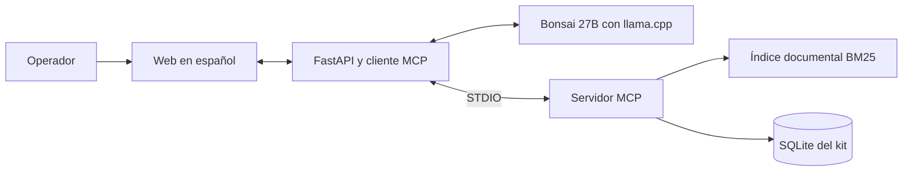
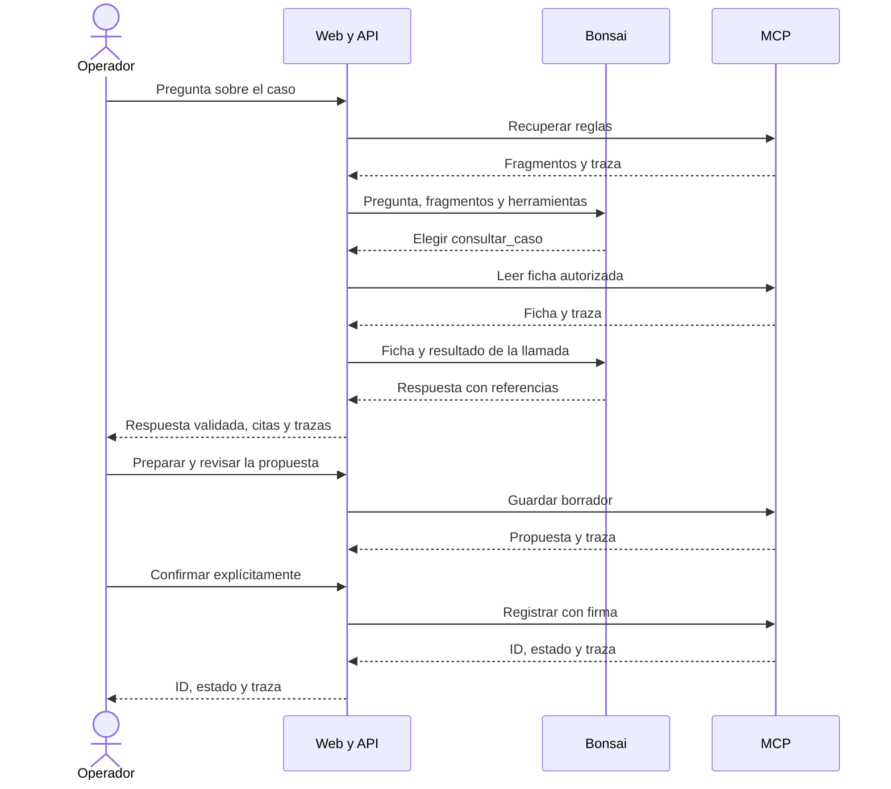

# Entrega 3 · Evidencia documental y acceso gobernado a MIRA

**Caso de uso** · CU-1, asistente del operador de revisión<br>
**Institución** · Universidad de Valparaíso, Escuela de Ingeniería Informática<br>
**Integrantes** · Francisca Meyer, Lukas Scheel y Sebastian Rodriguez<br>
**Representante del cliente** · Francisca Meyer<br>
**Entrega** · 9 de noviembre de 2026 a las 14:00<br>
**Repositorio** · [LLM_E3](https://github.com/franciscameyer/LLM_E3)<br>
**Versión técnica** · La etiqueta publicada [v3.0](https://github.com/franciscameyer/LLM_E3/tree/v3.0) apunta a `c555046`. El último cambio funcional es `6e86c44`. Las verificaciones de este informe usan ese mismo código.

## 1. Resumen ejecutivo

MIRA ayuda al operador a entender por qué un caso llegó a revisión. Reúne los datos autorizados, las reglas que los explican y sus fuentes. Presenta las discrepancias entre documentos e identifica la información que falta. Para registrar una solicitud de antecedentes exige confirmación explícita.

La búsqueda recuperó todos los fragmentos esperados en 16 de 16 preguntas con respuesta. En la reejecución con Bonsai, el asistente se abstuvo en las cuatro preguntas sin evidencia. La revisión técnica encontró dos respuestas con afirmaciones sin respaldo. El código etiquetado superó 47 pruebas. Francisca Meyer aprobó las veinte preguntas y expectativas como representante del cliente.

El prototipo trabaja con datos ficticios y las decisiones del caso quedan a cargo de la persona. Antes de la defensa, el equipo debe contrastar una muestra de respuestas y ensayar en el equipo que se usará para presentar.

## 2. Caso de uso y especificación

El operador de una organización cliente necesita explicar una derivación y preparar antecedentes. CU-1 reúne el corpus obligatorio y las siete tablas del kit con sus filas originales. Usa datos ficticios de aseguradora, clínica y banco. El servidor limita el acceso según rol y organización. Las decisiones sobre casos, los cambios de política y el recálculo de puntajes quedan fuera del CU-1.

| Necesidad | Componente y razón |
| --- | --- |
| Conocer mínimos, señales o procedimientos | RAG recupera la regla versionada y su fragmento. |
| Consultar puntaje, señales o historial | MCP verifica acceso y consulta los datos actuales del caso. |
| Explicar una derivación | RAG aporta la norma y MCP el hecho que se debe contrastar. |
| Solicitar antecedentes | MCP guarda la propuesta. La confirmación humana autoriza el registro. |

MAN-REV v1 §1 describe aprobación desde 80 sin fraude. POL-DEC v2 §2 usa 85 como referencia, con mínimos y condiciones. Ambas fuentes se declaran vigentes. En C-012, MCP reporta 86 puntos y umbral 90 en ORG-01. CU-001 muestra una sola aprobación del cambio y POL-DEC v2 §5 exige dos supervisores. El asistente presenta ambas discrepancias con su procedencia.

**Flujo principal.** El operador inicia sesión, elige un caso autorizado y pregunta por la derivación. La API recupera reglas, ejecuta llamadas MCP autorizadas y devuelve la respuesta con citas y trazas. Si la persona solicita antecedentes, revisa la propuesta y confirma. La web muestra el ID y el estado resultante.

| ID y fuente | Criterio de aceptación y flujo alternativo |
| --- | --- |
| RF-01 · PR-1 | Las decisiones quedan a cargo de la persona. El asistente explica y prepara. |
| RF-02 · PR-2 | Cada cita normativa abre el fragmento recibido con fuente, sección y versión. |
| RF-03 · PR-3 | Ante una pregunta por pesos del puntaje, indicar que la fórmula falta. |
| RF-04 · PR-4 | Exponer la diferencia 80/85 con ambas citas y sin elegir precedencia. |
| RF-05 · PR-5 | Vincular los datos del caso a una llamada MCP visible de esa consulta. |
| RF-06 · PR-6 | Preparar conserva el número de solicitudes. Confirmar exige firma válida. Una repetición devuelve el resultado previo. |
| RF-07 · PR-7 | Denegar C-020 a U-01 y las fichas individuales al rol de indicadores. |
| RF-08 · PRO-ANT v1 §4 | Denegar la tercera solicitud de C-016 al operador y bloquear solicitudes de un caso aprobado automáticamente. |
| RF-09 · Pauta §3.2 | Preservar las filas del Excel y representar cambios de estado con eventos. |
| RF-10 · Pauta §§4, 7.1 | Usar POL-DEC v2 para fraude actual y distinguir v1 en una consulta histórica. |
| RNF-01 · Pauta §6.2 | Construir el índice por separado de la búsqueda. |
| RNF-02 · Pauta §6.1 | Informar fallos de proveedor y retener citas inválidas con una explicación. |

Los siete principios están en la [constitución](docs/constitucion.md) y la [especificación](docs/especificacion-cu1.md) amplía los criterios. El [contraste de antecedentes](docs/contraste-antecedentes.md) documenta entrevistas de MIRA v1.4 y las actas e informe de E2. ENT4 y ENT5 justifican reunir motivo y evidencia en pantalla. ENT4 y ENT6 discrepan sobre quién cambia umbrales. La corrección oficial de E2 requiere el documento del docente.

## 3. Diseño e implementación del RAG

### 3.1. Corpus e inventario

| Código | Título | Origen | Estado y vigencia | Tokens aprox. |
| --- | --- | --- | --- | ---: |
| CAT-SEN v3 | Catálogo de señales de MIRA | Kit | Vigente desde 01-09-2026 | 752 |
| FAQ-OPE v2 | Preguntas frecuentes de operadores | Kit | Vigente desde 01-10-2026 | 383 |
| MAN-REV v1 | Manual de revisión asistida para operadores | Kit | Vigente desde 15-07-2026 | 607 |
| POL-DEC v1 | Política de decisión y umbrales | Kit | Derogada. Vigencia del 02-03 al 31-08-2026 | 359 |
| POL-DEC v2 | Política de decisión y umbrales | Kit | Vigente desde 01-09-2026 | 704 |
| PRO-ANT v1 | Procedimiento de solicitud de antecedentes | Kit | Vigente desde 15-07-2026 | 471 |
| MIRA-DESC v1.4 | Descripción de MIRA, extractos para CU-1 | Descripción | Contexto del 12-08-2026 | 972 |
| **Total** | **7 documentos** | | | **4248** |

El inventario registra además el archivo y su SHA-256. El tamaño se estima con palabras divididas por 0,75. Los extractos de la Descripción conservan su procedencia y los párrafos de §§2.6, 2.7, 2.11 y 2.13. Las entrevistas y actas se usan como antecedentes del informe.

### 3.2. Indexación y búsqueda

La indexación lee metadatos del encabezado, divide por secciones Markdown y corta las secciones largas por líneas. Cada parte conserva código, versión, sección y número, por ejemplo `POL-DEC@2#s02:01`. El índice JSON se genera por separado de la consulta.

BM25 normaliza mayúsculas y tildes, conserva códigos como `DOC_AUT` y pondera código, título, sección y texto. La búsqueda léxica aprovecha los términos específicos del corpus y evita calcular embeddings. Las paráfrasis con poco vocabulario compartido pueden perder evidencia. El ranking incluye una relación explícita del conflicto 80/85. Las contrapartes añadidas fuera de los seis resultados base se excluyen del Recall@6.

El modo operativo filtra por vigencia. La comparación histórica conserva la identificación de la norma derogada. La Descripción se recupera por mención explícita. Sus referencias de decisión (§2.6) y configuración (§2.13) se contrastan con el manual y la política del kit. Los 90 días de §2.11 se atribuyen al levantamiento del producto.

### 3.3. Experimento de fragmentación

Se mantuvieron las mismas preguntas y objetivos. Un objetivo cuenta solo cuando aparecen todas sus partes entre los seis resultados base.

| Límite en caracteres | Fragmentos | Objetivos completos | Preguntas completas | Contexto medio en caracteres |
| ---: | ---: | ---: | ---: | ---: |
| 300 | 67 | 10/18 | 8/16 | 1117,60 |
| 600 | 45 | 17/18 | 15/16 | 1678,10 |
| 900 | 41 | 18/18 | 16/16 | 1728,85 |
| 1800 | 39 | 18/18 | 16/16 | 1728,85 |

Se eligió 1800 porque empata con 900 en recuperación y conserva los cuatro extractos de la Descripción en cuatro partes. Las preguntas del golden se fijaron antes de esa ampliación. Las consultas específicas de MIRA v1.4 se evalúan por separado. [Comparación reejecutada en el cierre v3.0](evaluation/cierre_v3_20261107/fragmentacion.json).

### 3.4. Citas y políticas de respuesta

El asistente indica evidencia, abstención o conflicto. F1, F2 y las referencias siguientes se asignan solo a fragmentos mostrados al modelo. Las referencias desconocidas permiten un reintento con la misma evidencia y sin nuevas herramientas. Si persiste el error, se retiene la respuesta. Cuando falta una fuente obligatoria de un conflicto, la API explica la omisión y ofrece las citas del contraste. Los conflictos derivados solo del motivo del caso se vuelven obligatorios cuando el modelo cita sus reglas o cuando la búsqueda de la pregunta los exige. El respaldo de la afirmación requiere una revisión de contenido.

## 4. Diseño e implementación del servidor MCP

FastMCP usa STDIO. La API actúa como cliente y autentica cada proceso con una identidad firmada de usuario y sesión. El modelo elige herramientas y argumentos. Las consultas SQL parametrizadas y los filtros de acceso residen en el servidor.

SQLite importa 3 organizaciones, 8 usuarios, 14 casos, 68 señales, 15 evidencias, 2 solicitudes y 2 cambios de umbral. La carga verifica las filas del Excel. Los eventos, propuestas y auditoría se guardan aparte.

| Herramienta | Entrada y resultado |
| --- | --- |
| `buscar_reglas` | Pregunta, k de 1 a 12 e histórico opcional. Devuelve fragmentos, conflictos y advertencias. |
| `listar_casos` | Sin argumentos. Lista casos visibles de la organización del operador o supervisor. |
| `consultar_caso` | ID. Devuelve ficha, señales, evidencias, solicitudes y discrepancias. Deniega caso ajeno o rol sin permiso. |
| `listar_senales` | ID. Devuelve señales con la misma política de visibilidad. |
| `preparar_solicitud` | ID, documentos y motivo. Valida estado y límite. Devuelve propuesta vigente por 600 s. |
| `confirmar_solicitud` | ID de propuesta y firma. Registra una solicitud y un evento si se cumplen los controles. |
| `ver_propuestas` | Sin argumentos. Lista propuestas vigentes de la sesión. |
| `cancelar_propuesta` | ID de propuesta. Cancela una propuesta pendiente de la sesión. |
| `ver_trazas` | Sin argumentos. Devuelve hasta 40 llamadas de la sesión. |

Solo las cinco primeras se ofrecen al modelo. El recurso `mira://corpus/inventario` devuelve el inventario y el prompt `revisar_caso(caso_id)` guía el análisis. Cada llamada de negocio devuelve `ok`, `datos` o `error`, y `traza` con usuario, fecha, herramienta, argumentos y resultado. La auditoría omite la firma de confirmación. [Contratos y controles por herramienta](docs/contratos-mcp.md).

Preparar guarda un borrador. Tras el clic de confirmación, la API firma la autorización por 30 s y MCP revalida estado y límite en una transacción. Inserta solicitud, evento y aviso simulado, y evita duplicados. C-016 alcanza el límite de dos solicitudes para un operador. La denegación explica la regla de PRO-ANT v1 §4.

El [ensayo STDIO](evaluation/cierre_v3_20261107/mcp_externo.json) verificó contratos, permisos y cancelación. En este equipo, VS Code inició `mira-cu1-operador`, descubrió nueve herramientas y abrió el inventario real como recurso de solo lectura. [Registro de VS Code](evaluation/corroboracion_informe_v3/vscode_mcp.json). La prueba de permisos y acciones usó el cliente programático sobre una base temporal.

## 5. Arquitectura e implementación de frontend y backend



La web muestra ficha, conversación, estados, citas y trazas. FastAPI gestiona sesión y validación y coordina el modelo con MCP. La indexación y la importación se ejecutan en la preparación administrativa.



El modelo recibe la pregunta actual, instrucciones, contratos, fragmentos y resultados MCP autorizados. Contraseña, cookies y firma de confirmación quedan en el backend. El contexto es de 8192 tokens, con temperatura 0,1 y hasta 1000 tokens de salida. El modo documental y la revisión reconocida de instrucciones en la evidencia pueden responder directamente con resultados autorizados, sin generación.

**Contribuciones verificables.** El commit `b4336ea` registra la implementación base de RAG, MCP, interfaz e integración en la cuenta de trabajo «MIRA Local». Los commits `909f565` y `6e86c44`, atribuidos en el historial a `bladjot`, registran la ampliación del corpus y la revisión de evidencia. Francisca Meyer figura en `f27130b` y `c555046` para el informe y cierre. Codex apoyó implementación, documentación y verificaciones técnicas. La distribución individual de responsabilidades y revisiones requiere confirmación del equipo.

## 6. Evaluación

### 6.1. Diseño y trazabilidad

El [golden set](evaluation/golden.json) se fijó en `089b2fb`, antes de la primera ejecución completa. Contiene 12 preguntas con respuesta, 4 sin respuesta, 2 de conflicto y 2 de cambio de versión. Cada una identifica su expectativa y sus fragmentos. Francisca Meyer aprobó las veinte preguntas y expectativas el 7 de noviembre de 2026. [Registro de aprobación y huella](evaluation/cierre_v3_20261107/aprobacion_cliente.json).

La ejecución 06 se conserva como referencia histórica. La nueva ejecución repite el mismo golden con el código funcional de `v3.0`, una base aislada y Bonsai 27B local. La prueba inicial con todas las capas en GPU se interrumpió por el bajo rendimiento con esa configuración. La ejecución informada usó 55 capas en GPU y el resto en CPU, con 8192 tokens de contexto. [Entorno medido](evaluation/corroboracion_informe_v3/entorno.json) · [Respuestas, trazas y huellas de la nueva ejecución](evaluation/corroboracion_informe_v3/golden/resultados_generacion.json).

### 6.2. Resultados

| Métrica | Ejecución 06 | Reejecución v3.0 |
| --- | ---: | ---: |
| Recall@6 por fragmento esperado | 18/18 | 18/18 |
| Preguntas con todos sus fragmentos a k=6 | 16/16 | 16/16 |
| Consultas sin error de servicio o contrato | 20/20 | 20/20 |
| Abstenciones en preguntas sin respuesta | 4/4 | 4/4 |
| Abstenciones injustificadas | 0/16 | 0/16 |
| Citas que respaldan lo atribuido al fragmento, revisión de Codex | 30/30 | 32/32 |
| Respuestas completamente fieles, revisión de Codex | 20/20 | 18/20 |
| Manejo de conflicto y versión, revisión de Codex | 4/4 | 4/4 |

El Recall@6 excluye complementos fuera de los seis resultados base. Cada par respuesta y fragmento se cuenta una vez. Fidelidad exige respaldo para todas las afirmaciones. En C01 se presentan las dos reglas vigentes sin elegir precedencia, pero una afirmación adicional sobre la configuración reduce la fidelidad.

Las 20 consultas secuenciales de v3.0 promediaron 14,58 s, con mediana de 12,36 s y rango de 1,19 a 31,94 s. Ejecución 06 promedió 5,72 s. Las latencias pertenecen a sus respectivos entornos y rutas de ejecución. [Recuperación](evaluation/corroboracion_informe_v3/golden/resultados_recuperacion.json) · [Métricas recalculadas](evaluation/corroboracion_informe_v3/metricas_semanticas_codex.json).

### 6.3. Pruebas y revisión de contenido

La suite pasó 47/47 pruebas en este equipo. Cubre carga e integridad, vigencia, permisos, citas, confirmación, caducidad, concurrencia, idempotencia, MCP y sesión web. El entorno usa Python 3.12.14 y `pip check` no detectó incompatibilidades. [Registro de pruebas](evaluation/corroboracion_informe_v3/pruebas.xml).

El [ensayo previo de interfaz](evaluation/cierre_v3_20261107/ensayo_interfaz.json) comprobó apertura de citas, abstención de credenciales, recuperación del conflicto, alerta de E-007 y escritura confirmada. En C-011, preparar dejó cero solicitudes. Confirmar produjo una solicitud y un evento. Se conservó el estado original importado. La comprobación simulada `test_contraste_retiene_respuesta_que_omite_politica_vigente` verifica el mensaje y las fuentes al faltar la política. Las 20 respuestas nuevas del golden llegaron sin retenciones.

El [ensayo externo actualizado](evaluation/corroboracion_informe_v3/mcp_y_parafrasis.json) volvió a comprobar nueve herramientas, un recurso, un prompt, denegaciones y cancelación. Entre ocho paráfrasis, siete terminaron sin error. P06 quedó retenida porque omitió MAN-REV v1 en un contraste y la respuesta de validación ofreció las dos fuentes. En P07, la regla sobre señales faltantes está respaldada. La cita al FAQ para los datos particulares de C-018 sobra, porque esos datos provienen de la ficha MCP.

En la [repetición web con Bonsai](evaluation/corroboracion_informe_v3/ensayo_web_bonsai.json), P06 informó la instrucción aislada y permitió abrir POL-DEC v2 §5 y las trazas. No volvió a retenerse. La respuesta añadió puntaje y umbrales que no se pedían.

Los cinco contrastes de MIRA v1.4 cumplieron el estado y las citas esperadas. La respuesta sobre retención distinguió los 90 días de la Descripción del plazo ausente en el kit. Para D8 se ensayaron dos preguntas nuevas formuladas por Codex a petición del usuario. La primera recuperó E-005 y E-006 de C-013 mediante MCP y citó PRO-ANT §4 para los roles. La segunda se abstuvo ante la falta de un plazo de conservación de correos. Ambas pasaron el control estructural. El ensayo con una pregunta espontánea de un participante corresponde a la defensa. [Contrastes y respuestas nuevas](evaluation/corroboracion_informe_v3/contrastes_y_d8.json).

La [concordancia técnica de ejecución 06](evaluation/cierre_v3_20261107/concordancia_tecnica.json) fue 8/8 en fidelidad y cantidad de citas, y 3/3 en conflicto y vigencia. Para el contraste humano, la [planilla de ocho respuestas nuevas](evaluation/corroboracion_informe_v3/muestra_humana.csv) identifica la ejecución por SHA-256. El revisor debe comparar texto y fragmentos, registrar fecha y juicios, y calcular acuerdos por dimensión. La concordancia humana permanece pendiente.

### 6.4. Fallos y ciclo de mejora

Primero se verifica si llegó la evidencia requerida. Si faltó, se clasifica como recuperación. Si llegó y se omitió o se añadió una afirmación sin respaldo, se clasifica como generación. Los errores de servicio y validación se registran aparte.

| Caso | Hallazgo y comprobación |
| --- | --- |
| CAT-SEN · indexación | Una columna del cuerpo sobrescribía el código. Leer solo el encabezado corrigió la extracción. La suite cubre la regresión. |
| R10 · generación | El modelo agregaba una regla de umbral ajena al rol. El ajuste de orden y el control de fuentes corrigen el caso probado. En v3.0 respondió con PRO-ANT §4. |
| P07 · recuperación y generación | Faltaba la regla de señal ausente y se emitían IDs inválidos. Se recupera POL-DEC v2 §6 desde el motivo y se exigen referencias exactas. |
| A04 · generación | La abstención inventaba un canal de recuperación. La ruta de credenciales responde con abstención controlada. |
| A01 · generación | El asistente se abstuvo sobre los pesos, pero sugirió buscar la fórmula en POL-DEC v2 §5. Esa sección regula cambios de umbral. |
| C01 · generación | El asistente mostró 80 y 85, pero ubicó el umbral efectivo en la sección 5. El procedimiento está en la política y el valor efectivo se consulta mediante MCP. |
| C-031 · orquestación | El contraste del motivo podía bloquear una inspección de evidencia. La ruta directa consulta MCP y aplica permisos. Las tres variantes se probaron en la suite. |

### 6.5. Reproducción

Con dependencias fijadas según [instalación y verificación](docs/reproduccion.md), ejecutar en PowerShell con una base nueva y Bonsai disponible. Usar una salida distinta para cada repetición.

```powershell
$env:MIRA_DATA_DIR = Join-Path $PWD '.cache/verificacion-nueva'
.\.venv\Scripts\python.exe -m mira.cli preparar
.\.venv\Scripts\python.exe -m pytest -q
.\.venv\Scripts\python.exe -m mira.cli evaluar --generacion --salida .cache/golden-nuevo
```

## 7. Riesgos y controles

| Riesgo | Control | Evidencia y límite |
| --- | --- | --- |
| Instrucciones incrustadas en la evidencia | MCP aísla el texto de E-007 y conserva el original. | C-014 muestra alerta. El detector cubre patrones conocidos. |
| Acceso a otro rol u organización | Identidad firmada y filtro de acceso en el servidor. | Se deniegan U-01/C-020 y U-03/ficha. La autenticación usa usuarios ficticios. |
| Escritura sin autorización, duplicada o concurrente | Firma por sesión y acción, caducidad, transacción e idempotencia. | Pruebas de firmas y concurrencia. C-011 registra solo después de confirmar. |
| Referencia inválida o contradicción omitida | Comparación exacta de citas y exigencia de ambas fuentes del conflicto. | La suite comprueba rechazo y mensaje. El respaldo semántico se mide por separado. |
| Norma derogada o contexto usado como política | Filtros de vigencia y atribución explícita a la Descripción. | Pruebas de versiones y contrastes 80/85. El kit no resuelve conflictos nuevos. |
| SQL inyectado o alteración de originales | SQL parametrizado y verificación de filas importadas. | Pruebas con argumentos maliciosos y comparación con Excel. |
| Caída del modelo o solicitud desde otro origen | Errores explícitos, CSRF, cookies de sesión y filtro de origen/host. | Pruebas de indisponibilidad y sesión. El alcance verificado es localhost. |

[Mapa de riesgos y pruebas](docs/riesgos-controles.md). La escritura de negocio disponible es la solicitud de antecedentes, con confirmación humana. En el [ensayo de interfaz](evaluation/cierre_v3_20261107/ensayo_interfaz.json) se verificaron la alerta de E-007, la traza y el efecto confirmado en C-011.

## 8. Discusión y conclusiones

En C-012, la política explica los requisitos de aprobación y MCP muestra el puntaje, el umbral reportado y el historial. Juntos permiten explicar por qué una aprobación registrada deja abierta la validez del cambio. El conflicto 80/85 requiere presentar ambas reglas vigentes. Si falta CRUCE_MONTO en C-018, el asistente debe reconocer esa ausencia.

P07 mostró que la recuperación y la generación pueden fallar en la misma consulta. Primero faltó la regla de la señal ausente. Después el modelo emitió una referencia inválida. En v3.0, P07 superó tres repeticiones con la cita de POL-DEC v2 §6. A04 también superó tres repeticiones con la abstención controlada. [Registro de regresiones](evaluation/corroboracion_informe_v3/regresiones/resultados.json). Una cita válida todavía puede acompañar una afirmación sin respaldo, por eso la evaluación separa recuperación, formato y fidelidad.

El CU-1 demuestra recuperación, acceso autorizado y escritura confirmada en un entorno local. El equipo debe completar la muestra humana y medir concordancia, confirmar la sección académica y las contribuciones individuales, y ensayar los 15 minutos en el equipo definitivo. El [guion D1–D8](docs/guion-demostracion-v3.md) se basa en P2. La corrección de E2 y cualquier instrucción adicional del docente sobre D1–D8 requieren su fuente original.
