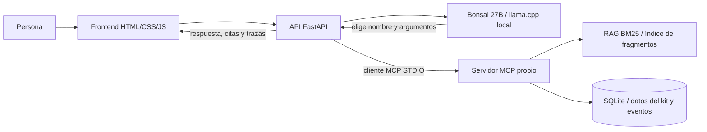
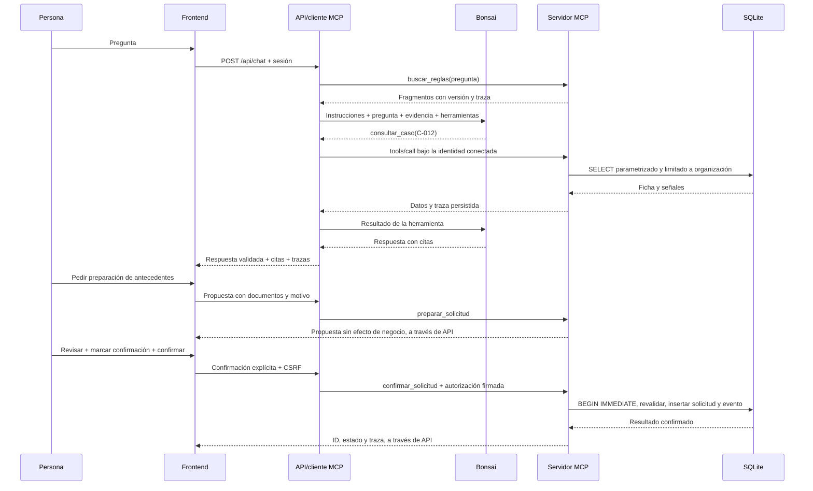

# Arquitectura e implementación

## Componentes

La API no importa `store` ni ejecuta SQL. La carga administrativa es la única
excepción al acceso exclusivo del servidor MCP a la base de negocio. El índice
documental es independiente de la base de casos.

## Secuencia de consulta y acción

## Contratos MCP

Toda herramienta de negocio devuelve `{ok, datos|error, traza}`. La traza
incluye ID, fecha, usuario, nombre, argumentos sin secretos, resultado y estado.
Las herramientas de lectura llevan `readOnlyHint=true`. Preparar se marca como
escritura porque persiste una propuesta, aunque no cambia el caso ni inserta una
solicitud. Las lecturas solo añaden auditoría, sin efectos de negocio.

| Herramienta | Parámetros | Control principal |
| --- | --- | --- |
| buscar_reglas | pregunta, k, historico | Vigencia predeterminada; fuente y versión |
| listar_casos | Ninguno | Operador/supervisor, organización conectada |
| consultar_caso | caso_id | Misma organización, rol autorizado |
| listar_senales | caso_id | Visibilidad del caso antes de consultar |
| preparar_solicitud | caso_id, documentos, motivo | PRO-ANT §2 y §4; propuesta por sesión |
| confirmar_solicitud | accion_id, autorización | Firma, sesión, caducidad, límites, transacción e idempotencia |
| ver_propuestas | Ninguno | Solo propuestas propias de la sesión |
| cancelar_propuesta | accion_id | Solo propuesta propia pendiente |
| ver_trazas | Ninguno | Solo llamadas propias de la sesión |

El modelo solo ve las primeras cinco herramientas. Ninguna acepta SQL,
identidad, rol u organización como argumento. El servidor recibe una identidad
firmada mediante el entorno del proceso, fuera del contexto del modelo.

Primitivas adicionales: recurso `mira://corpus/inventario` y prompt `revisar_caso`.

## Datos enviados al modelo

Se envían la pregunta actual, las instrucciones, los contratos de las herramientas,
los fragmentos recuperados y los resultados de las llamadas que efectúe. Los
resultados pueden incluir datos ficticios de organizaciones, usuarios, señales y
evidencias del caso autorizado. El texto sospechoso de E-007 se aísla antes de
entrar en el contexto. Los originales permanecen en SQLite.

No se envían la contraseña de demostración, cookies, claves de sesión, tokens MCP
ni autorizaciones de confirmación. Los textos usados para búsqueda y las copias
de resultados en auditoría se excluyen para no duplicar el contexto.

## Límites y controles

- Dos rondas de herramientas y una etapa final de respuesta; hasta cinco llamadas
  por ronda y timeout por llamada. El historial se compacta, conservando fuentes y
  observaciones MCP; las trazas originales permanecen completas fuera del modelo.
- Lista explícita de herramientas permitidas; confirmación fuera del modelo.
- Citas verificadas contra los fragmentos recibidos, sin confundir esa comprobación
  estructural con respaldo semántico.
- Si aparecen IDs desconocidos, se permite un único reintento de generación con
  la misma evidencia y sin herramientas. Se aplican otra vez todos los controles;
  no se sustituyen IDs por semejanza ni se acepta una cita inválida tras el reintento.
- No se presentan datos de casos nombrados si no se obtuvieron por MCP en esa consulta.
- Una denegación por rol u organización se muestra directamente como abstención
  con traza, sin pedir al modelo reformularla ni permitirle completar datos.
- Conflictos conocidos omitidos y decisiones atribuidas al asistente se retienen.
- Cuando una fuente recuperada contiene la regla en conflicto, se incorpora su
  contraparte como complemento identificado. Recall@k se calcula sobre los seis
  resultados base, sin contar esos complementos. La generación conserva el orden
  de relevancia para no dar prioridad a fragmentos marginales.
- Cookies HttpOnly/SameSite, comprobación de origen/host y CSRF para las mutaciones web.
- Acceso local de demostración; contraseña compartida, sin identidades de producción.
- Aislar una instrucción conocida no garantiza detectar todas las formas de prompt
  injection. El límite de herramientas y las validaciones siguen aplicando.
